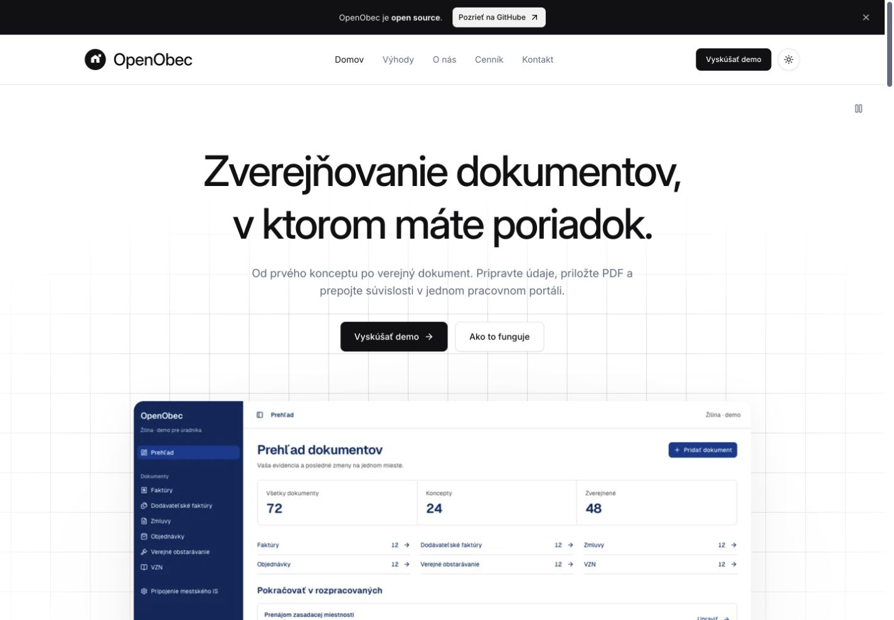
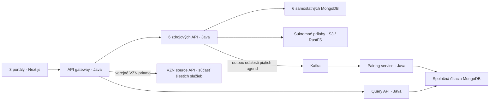

# OpenObec

## Dokumenty obce pod kontrolou. Od konceptu až k občanovi.

**Pripravte údaje, priložte PDF a zverejnite dokument z jedného miesta.** OpenObec pomáha úradníkom udržať poriadok vo faktúrach, zmluvách, objednávkach a ďalších dokumentoch samosprávy. Občanovi ponúka prehľadný verejný portál, v ktorom nájde dokument aj jeho súvislosti.

[**Spoznajte OpenObec →**](https://openobec.sk) · [Čo prináša úradu](#čo-prináša-vášmu-úradu) · [Spustiť vlastné demo](#rýchly-štart) · [Otvorený kód, licencia MIT](LICENSE)



## Čo prináša vášmu úradu

| Pri každodennej práci | Ako pomôže OpenObec |
|---|---|
| Dokument ešte nie je pripravený na zverejnenie | Uložte koncept a dokončite ho neskôr. Rozpracované a zverejnené záznamy sú oddelené. |
| Údaje sú na jednom mieste, PDF na inom | Prílohu pridajte priamo k záznamu. Názov, dátumy, sumy a súbor zostanú spolu. |
| Faktúra súvisí so zmluvou alebo objednávkou | Prepojte dokumenty a prechádzajte medzi nimi bez opakovaného hľadania. |
| Občan potrebuje nájsť konkrétny dokument | Verejný portál ponúka zoznamy, vyhľadávanie, filtre, detail aj stiahnutie príloh. |
| Chcete vedieť, ako systém funguje | Zdrojový kód aj postup spustenia sú otvorené. Projekt si môžete preskúmať, upraviť a prevádzkovať vo vlastnom prostredí. |

### Šesť agend, jeden spôsob práce

**Faktúry · Dodávateľské faktúry · Zmluvy · Objednávky · Verejné obstarávanie · VZN**

Nemusíte sa učiť nový postup pre každú agendu. Vyberiete typ dokumentu, doplníte údaje a prílohy a rozhodnete o zverejnení.

### Od prípravy po verejný dokument

1. **Pripravte dokument.** Vyplňte údaje a uložte koncept.
2. **Doplňte PDF a súvislosti.** Priložte súbor a prepojte súvisiace záznamy.
3. **Zverejnite a overte výsledok.** Otvorte verejný detail a pozrite si ho z pohľadu občana.

[Pozrieť skutočný priebeh zverejnenia — video, 39 sekúnd](docs/media/showcase/publication.webm) · [Pôvod záznamu a titulky](docs/media/showcase/README.md)

## Vyskúšajte si obe strany obce

**Pre úradníka:** pracovný prehľad, evidencia dokumentov, koncepty, prílohy, prepojenia a zverejnenie.

**Pre občana:** verejné dokumenty, vyhľadávanie, údaje, PDF a súvisiace záznamy bez vstupu do pracovného prostredia.

[**Vyskúšať demo v prehliadači →**](https://openobec.sk/demo)

Funkčné demo si môžete spustiť aj vo vlastnom prostredí podľa návodu nižšie. Pracuje so skutočným ukladaním dát a príloh, s fiktívnymi dokumentmi pre Žilinu. Nie je oficiálnym portálom mesta.

### Čo je hotové a čo pripravujeme

Dnes si môžete vyskúšať celý postup od konceptu po verejný dokument. Prihlásenie je ukážkové; systém zatiaľ nie je určený na spracovanie skutočných úradných dokumentov vo verejnej produkcii. Reálne overovanie identity, pripojenie mestského IS a externých registrov, inteligentné vyhľadávanie a viac obcí patria k ďalšiemu rozvoju. OpenObec nenahrádza povinnosti zverejnenia v externých registroch.

**Máte podnet z praxe úradu alebo chcete prispieť?** [Napíšte nám](https://openobec.sk/kontakt) alebo [otvorte podnet na GitHube](https://github.com/SajMoooner/OpenObec/issues). Zaujíma nás, kde pri evidencii a zverejňovaní strácate najviac času.

---

## Rýchly štart

Potrebujete Git, Docker s Compose v2 a Python 3.9+ (štandardná knižnica). Dockeru odporúčame prideliť aspoň 8 GiB pamäte. Prvý štart sťahuje závislosti a zostavuje aplikácie; porty uvedené nižšie musia byť voľné.

```sh
git clone https://github.com/SajMoooner/OpenObec.git
cd OpenObec
cp .env.example .env
scripts/dev/up.sh docker
scripts/dev/doctor.sh docker
```

`.env.example` obsahuje iba lokálne demo nastavenia; nie sú určené na verejné nasadenie. Spúšťač počká na služby, pri prvom štarte obnoví čítaciu projekciu a vytvorí syntetické dáta cez API.

| Aplikácia | Lokálna adresa |
|---|---|
| Úvodná stránka | [localhost:3000](http://localhost:3000) |
| Portál občana | [localhost:3001](http://localhost:3001) |
| Portál úradníka | [localhost:3002](http://localhost:3002) |
| API gateway | [localhost:8080](http://localhost:8080/actuator/health) |

Zdrojové API používajú porty 8081–8086, Query 8090 a pairing 8091. API požiadavky vyžadujú hlavičku `X-Obec-Id: zilina`. Publikované porty sa viažu na localhost; databázy a prílohy sa neposkytujú cez verejný web priamo.

```sh
scripts/dev/down.sh docker
# Opätovný štart zachová dáta:
scripts/dev/up.sh docker
```

Vypnutie zachová zväzky, prílohy aj Kafka históriu. Ponechajte aj `.run/seed-manifest.json`: seed vďaka nemu zachová používateľské úpravy a zmazané záznamy. Úplné vymazanie je samostatný, výslovne potvrdený krok v [runbooku](docs/runbook.md). Postup aktualizácie starších ukážok vrátane zálohy a pokračovania po prerušení je v [správe seed dát](docs/seed.md).

### Vývoj na hostiteľovi

Okrem Dockeru a Pythonu potrebujete **JDK 21**, **Node.js 26** a **pnpm 11.25.0**. Nastavte `JAVA_HOME` na vlastnú inštaláciu JDK. Režimy nespúšťajte súčasne: najprv vypnite aktívny režim.

```sh
scripts/dev/up.sh manual
scripts/dev/doctor.sh manual
scripts/dev/down.sh manual
```

Ručný režim zostaví Java služby aj frontend a spustí ich na hostiteľovi; infraštruktúra ostáva v Dockeri. Na živé úpravy jedného portálu po uvoľnení jeho portu slúžia `pnpm dev:marketing`, `pnpm dev:citizen` a `pnpm dev:office`. Logy a evidencia spustených procesov sú v `.run/`; riešenie výpadkov a obnova projekcie sú v [runbooku](docs/runbook.md).

Verejné nasadenie, HTTPS, limity prostriedkov a návrat na predchádzajúcu verziu opisuje [prevádzkový návod](docs/deployment.md).

## Ako je projekt postavený



Každá agenda vlastní svoje dáta. Pairing spracúva udalosti piatich prepájaných agend a zapisuje projekciu; Query číta tú istú čítaciu databázu. VZN ide verejnou cestou priamo do svojej zdrojovej služby. Prílohy sa sprístupňujú cez API. Podrobnosti: [OpenAPI](contracts/openapi.yaml), [rozhodnutia](docs/decisions.md), [návrh](docs/superpowers/specs/2026-11-01-openobec-design.md), [read model](libs/java/read-model/README.md), [pairing](services/pairing-service/README.md) a [Query](services/query-api/README.md).

Portály používajú komponenty shadcn/ui a ikony Lucide. Občiansky a pracovný portál používajú font Geist a farby IDSK3; marketing má vlastnú neutrálnu paletu, fialové akcenty a font Inter ([vizuálny systém](DESIGN.md)).

| Priečinok | Obsah |
|---|---|
| `apps/` | Úvodná stránka, portál občana a portál úradníka |
| `packages/` | Zdieľané UI a typovaný API klient |
| `services/` | Java služby agend, gateway, Query a pairing |
| `libs/java/` | Spoločné rozhrania, čítací model a úložisko |
| `contracts/` | Autoritatívna OpenAPI špecifikácia |
| `scripts/` | Lokálny štart, seed, obnova a smoke kontroly |
| `tests/` | Kontrakty, integračné skúšky a browser testy |
| `docs/` | Návrh, prevádzka, overenia a médiá |

## Overenie a prispievanie

[Príručka pre prispievateľov](CONTRIBUTING.md) opisuje lokálne kontroly aj postup cez pull request. Na spustenom stacku môžete spustiť:

```sh
pnpm install --frozen-lockfile
pnpm exec playwright install chromium
python3 -m venv .tools/venv
.tools/venv/bin/pip install -r tests/integration/requirements.txt
./mvnw -B verify
pnpm typecheck
pnpm lint
pnpm test:frontend
pnpm build
scripts/smoke/run.sh
pnpm test:e2e
```

Smoke kontroluje seed, PDF, súvislosti a odpovede OpenAPI. Skúšky výpadkov/obnovy spúšťajte oddelene podľa [runbooku](docs/runbook.md). Existujúci [GitHub Actions workflow](.github/workflows/verify.yml) definuje automatické kontroly; uložené lokálne výsledky nájdete v [prehľade overenia](docs/verification.md). Produktový kontext je v [PRODUCT.md](PRODUCT.md).

## Licencia

Vlastný kód a dokumentácia OpenObec sú dostupné pod licenciou [MIT](LICENSE). Fonty, ikony, prevzaté komponenty a ostatné závislosti majú vlastných autorov a licenčné podmienky; pozrite [THIRD_PARTY_NOTICES.md](THIRD_PARTY_NOTICES.md).
