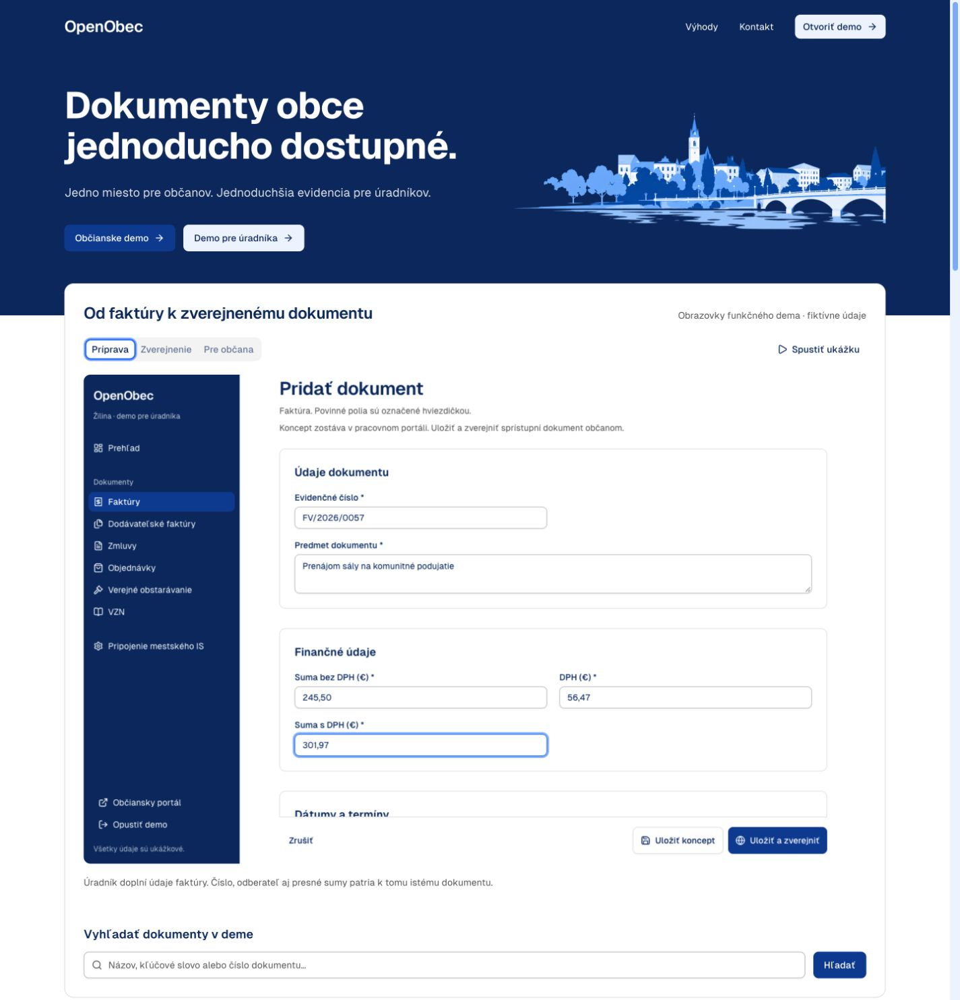
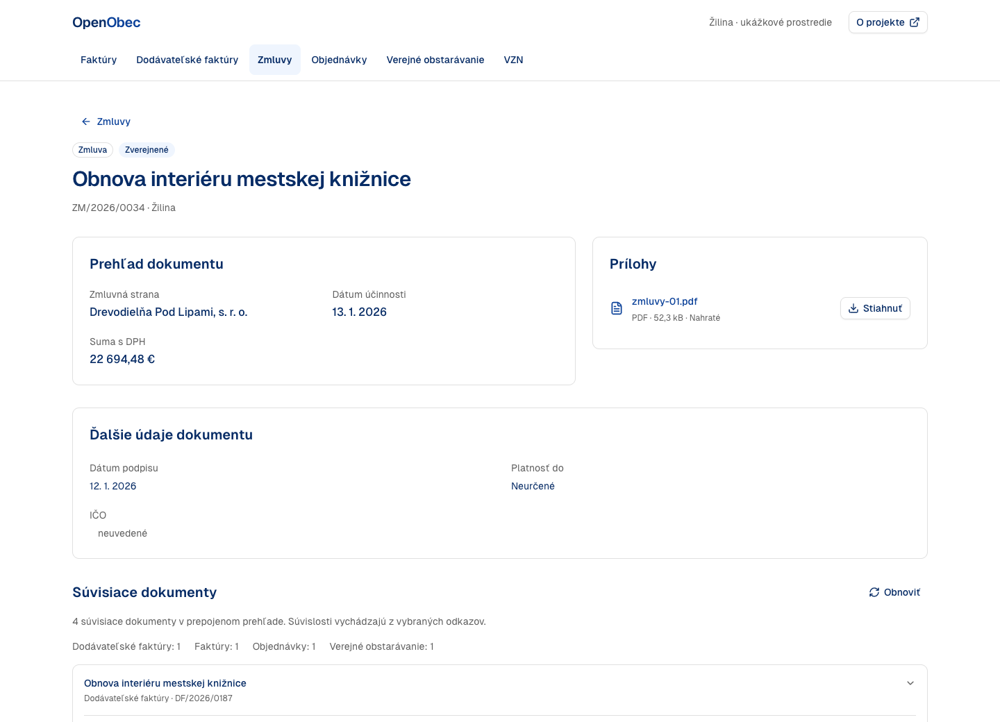
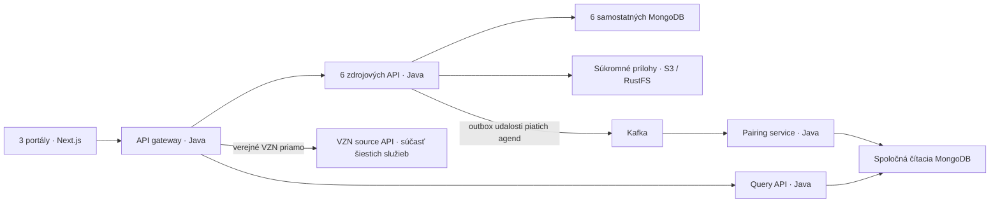

# OpenObec

**Dokumenty obce jednoducho dostupné.** Jedno miesto pre občanov, jednoduchšia evidencia pre úradníkov.

OpenObec je otvorený prototyp evidencie a zverejňovania obecných dokumentov. Úradník pripraví dokument, pripojí PDF a zverejní ho; občan nájde údaje, prílohy aj súvisiace dokumenty v samostatnom verejnom portáli.



[Pozrieť skutočný priebeh zverejnenia — video, 39 sekúnd](docs/media/showcase/publication.webm) · [Pôvod záznamu a titulky](docs/media/showcase/README.md)

## Čo si môžete vyskúšať

- **Tri portály:** úvodná stránka, verejný portál občana a pracovný portál úradníka.
- **Šesť agend:** faktúry, dodávateľské faktúry, zmluvy, objednávky, verejné obstarávanie a všeobecne záväzné nariadenia (VZN).
- **Od konceptu po zverejnenie:** vytváranie a úprava údajov, prílohy PDF, koncepty a publikované dokumenty.
- **Prehľad pre občana:** zoznamy, vyhľadávanie a filtre, detail dokumentu, stiahnutie príloh a prepojené súvislosti.
- **Lokálny systém so skutočnými službami:** zápis cez zdrojové API, udalosti Kafka, čítacia projekcia a súkromné úložisko príloh.



Snímky zachytávajú funkčné lokálne demo s fiktívnymi údajmi ([pôvod snímok](apps/marketing/public/previews/README.md)). Nový seed pripraví 12 dokumentov na agendu a 72 PDF; ďalšie používanie počty mení. Projekt nie je oficiálnou službou mesta Žilina ani hotovým produkčným systémom. Prihlásenie je ukážkové, mestský IS ani externé registre nie sú pripojené. Reálne overovanie identity, inteligentné vyhľadávanie a podpora viacerých obcí patria k budúcemu rozvoju.

## Rýchly štart

Potrebujete Git, Docker s Compose v2 a Python 3.9+ (štandardná knižnica). Dockeru odporúčame prideliť aspoň 8 GiB pamäte. Prvý štart sťahuje závislosti a zostavuje aplikácie; porty uvedené nižšie musia byť voľné.

```sh
git clone https://github.com/SajMoooner/OpenObec.git
cd OpenObec
cp .env.example .env
scripts/dev/up.sh docker
scripts/dev/doctor.sh docker
```

`.env.example` obsahuje iba lokálne demo nastavenia; nie sú určené na verejné nasadenie. Spúšťač počká na služby, pri prvom štarte obnoví čítaciu projekciu a vytvorí syntetické dáta cez API.

| Aplikácia | Lokálna adresa |
|---|---|
| Úvodná stránka | [localhost:3000](http://localhost:3000) |
| Portál občana | [localhost:3001](http://localhost:3001) |
| Portál úradníka | [localhost:3002](http://localhost:3002) |
| API gateway | [localhost:8080](http://localhost:8080/actuator/health) |

Zdrojové API používajú porty 8081–8086, Query 8090 a pairing 8091. API požiadavky vyžadujú hlavičku `X-Obec-Id: zilina`. Publikované porty sa viažu na localhost; databázy a prílohy sa neposkytujú cez verejný web priamo.

```sh
scripts/dev/down.sh docker
# Opätovný štart zachová dáta:
scripts/dev/up.sh docker
```

Vypnutie zachová zväzky, prílohy aj Kafka históriu. Ponechajte aj `.run/seed-manifest.json`: seed vďaka nemu zachová používateľské úpravy a zmazané záznamy. Úplné vymazanie je samostatný, výslovne potvrdený krok v [runbooku](docs/runbook.md). Postup aktualizácie starších ukážok vrátane zálohy a pokračovania po prerušení je v [správe seed dát](docs/seed.md).

### Vývoj na hostiteľovi

Okrem Dockeru a Pythonu potrebujete **JDK 21**, **Node.js 26** a **pnpm 11.25.0**. Nastavte `JAVA_HOME` na vlastnú inštaláciu JDK. Režimy nespúšťajte súčasne: najprv vypnite aktívny režim.

```sh
scripts/dev/up.sh manual
scripts/dev/doctor.sh manual
scripts/dev/down.sh manual
```

Ručný režim zostaví Java služby aj frontend a spustí ich na hostiteľovi; infraštruktúra ostáva v Dockeri. Na živé úpravy jedného portálu po uvoľnení jeho portu slúžia `pnpm dev:marketing`, `pnpm dev:citizen` a `pnpm dev:office`. Logy a evidencia spustených procesov sú v `.run/`; riešenie výpadkov a obnova projekcie sú v [runbooku](docs/runbook.md).

## Ako je projekt postavený



Každá agenda vlastní svoje dáta. Pairing spracúva udalosti piatich prepájaných agend a zapisuje projekciu; Query číta tú istú čítaciu databázu. VZN ide verejnou cestou priamo do svojej zdrojovej služby. Prílohy sa sprístupňujú cez API. Podrobnosti: [OpenAPI](contracts/openapi.yaml), [rozhodnutia](docs/decisions.md), [návrh](docs/superpowers/specs/2026-11-01-openobec-design.md), [read model](libs/java/read-model/README.md), [pairing](services/pairing-service/README.md) a [Query](services/query-api/README.md).

Rozhranie používa komponenty shadcn/ui, font Geist a ikony Lucide. Z IDSK3 preberá farebnú paletu; nejde o implementáciu celého komponentového systému IDSK ([vizuálny systém](DESIGN.md)).

| Priečinok | Obsah |
|---|---|
| `apps/` | Úvodná stránka, portál občana a portál úradníka |
| `packages/` | Zdieľané UI a typovaný API klient |
| `services/` | Java služby agend, gateway, Query a pairing |
| `libs/java/` | Spoločné rozhrania, čítací model a úložisko |
| `contracts/` | Autoritatívna OpenAPI špecifikácia |
| `scripts/` | Lokálny štart, seed, obnova a smoke kontroly |
| `tests/` | Kontrakty, integračné skúšky a browser testy |
| `docs/` | Návrh, prevádzka, overenia a médiá |

## Overenie a prispievanie

[Príručka pre prispievateľov](CONTRIBUTING.md) opisuje lokálne kontroly aj postup cez pull request. Na spustenom stacku môžete spustiť:

```sh
pnpm install --frozen-lockfile
pnpm exec playwright install chromium
python3 -m venv .tools/venv
.tools/venv/bin/pip install -r tests/integration/requirements.txt
./mvnw -B verify
pnpm typecheck
pnpm lint
pnpm test:frontend
pnpm build
scripts/smoke/run.sh
pnpm test:e2e
```

Smoke kontroluje seed, PDF, súvislosti a odpovede OpenAPI. Skúšky výpadkov/obnovy spúšťajte oddelene podľa [runbooku](docs/runbook.md). Existujúci [GitHub Actions workflow](.github/workflows/verify.yml) definuje automatické kontroly; uložené lokálne výsledky nájdete v [prehľade overenia](docs/verification.md). Produktový kontext je v [PRODUCT.md](PRODUCT.md).

## Licencia

Vlastný kód a dokumentácia OpenObec sú dostupné pod licenciou [MIT](LICENSE). Fonty, ikony, prevzaté komponenty a ostatné závislosti majú vlastných autorov a licenčné podmienky; pozrite [THIRD_PARTY_NOTICES.md](THIRD_PARTY_NOTICES.md).
