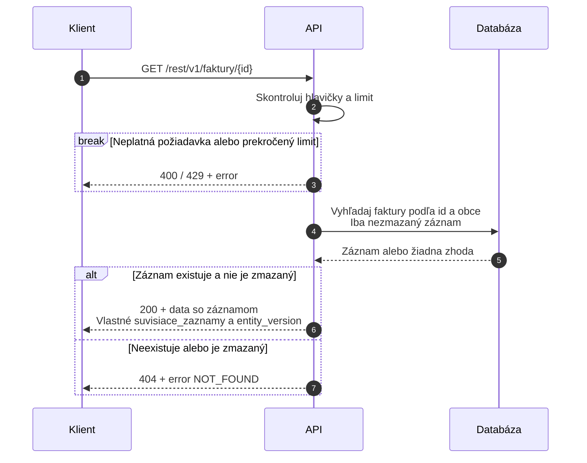
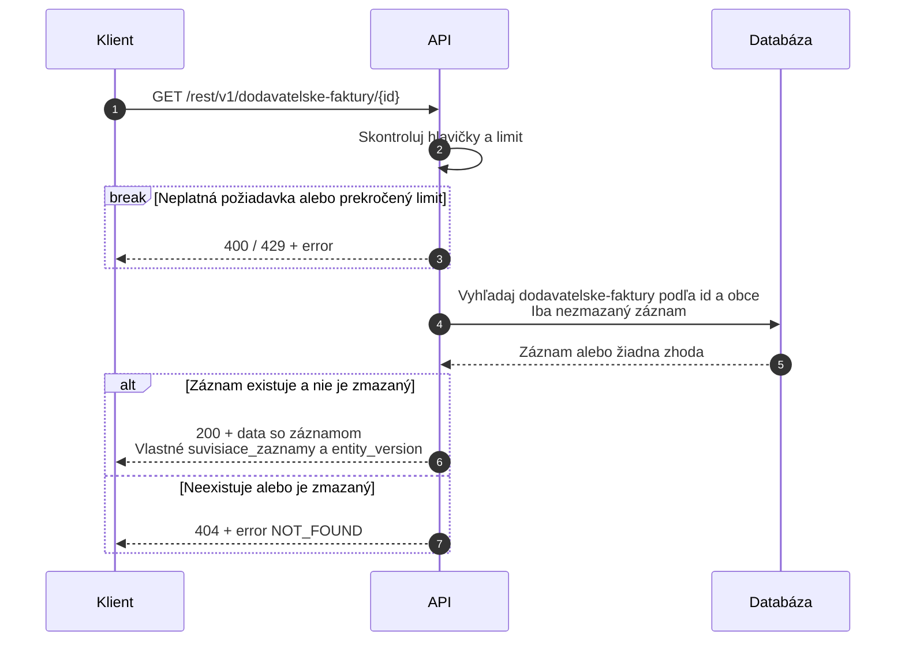
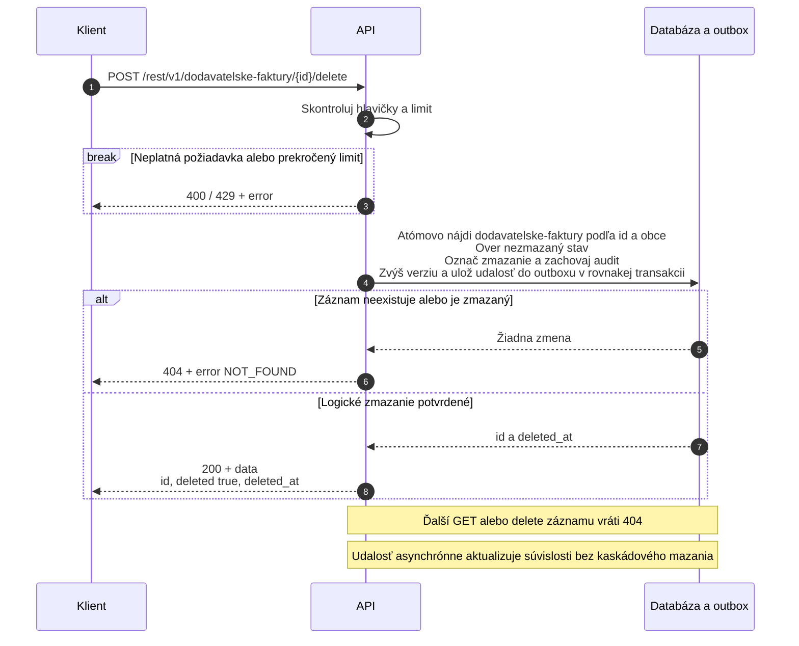
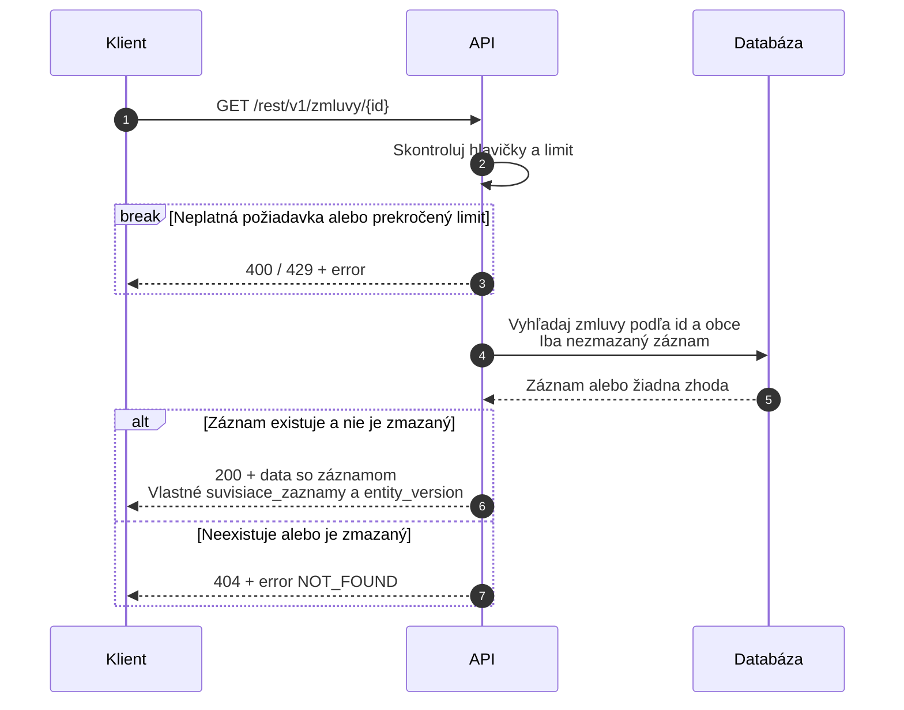
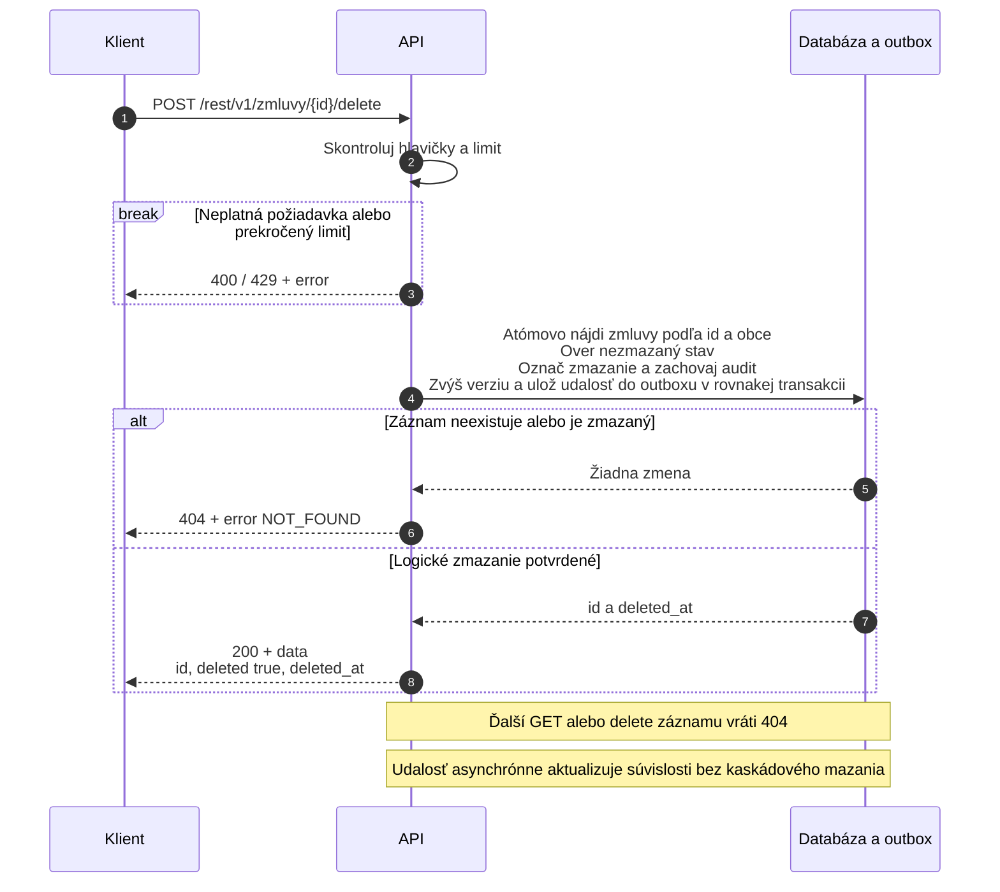
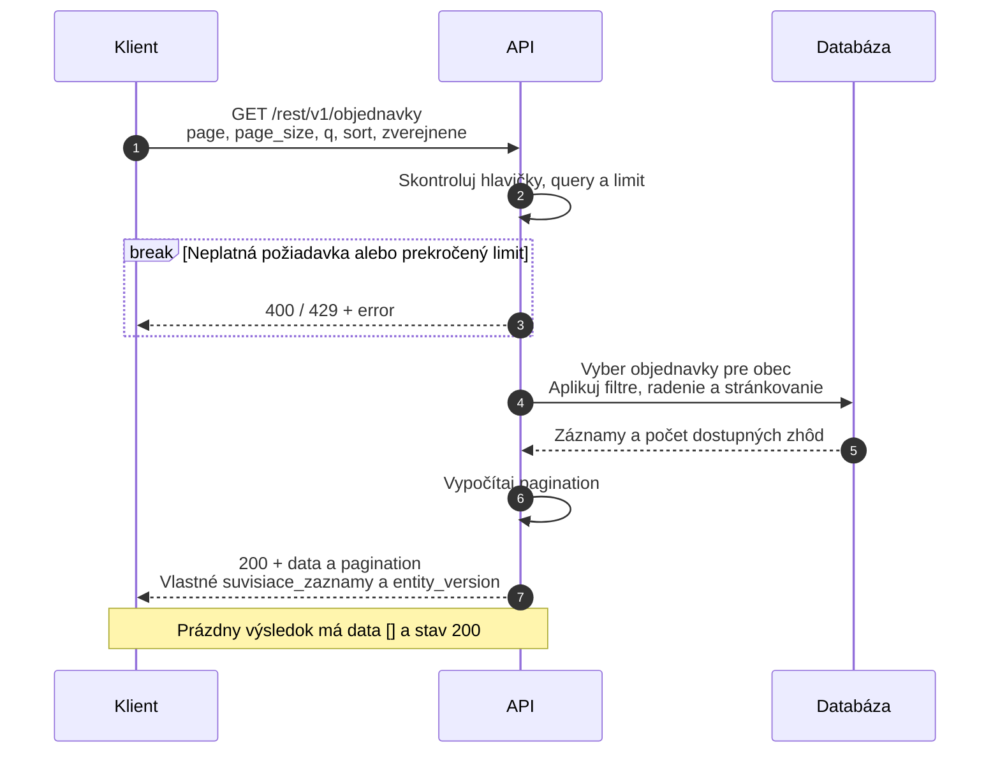
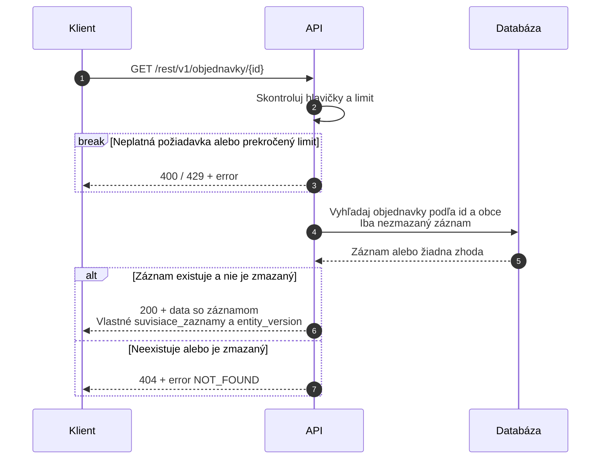
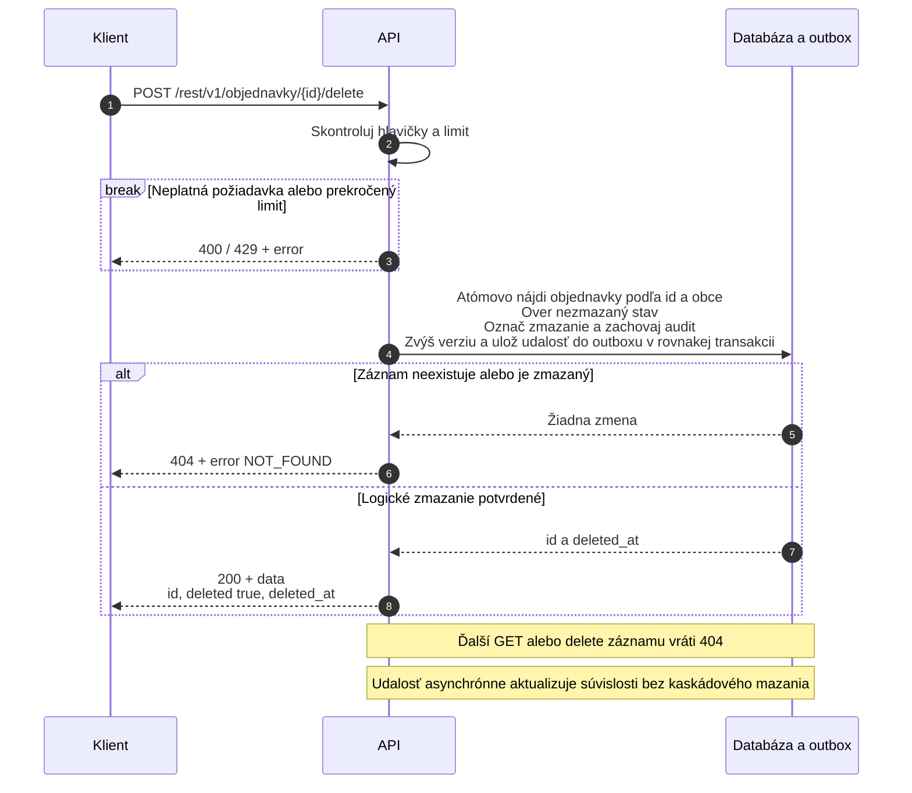

Sekvenčné diagramy 46 dátových endpointov OpenObec: 30 pôvodných operácií, 6 endpointov pre výber a súvislosti a 10 nových read endpointov nad joined view. Zahŕňajú zoznamy, plné prepojené detaily a spracovanie zmien cez MQ. Nadväzujú na [API Definiton](https://chatgpt.com/space/page_770f55727c0081918bf54e26130bf30f) a [API detail](https://chatgpt.com/space/page_6ae6110469408191a2399b407bb11f3c).

# Ako čítať diagramy

Klient je občiansky alebo úradnícky portál. API zabezpečuje validáciu a spracovanie, Databáza uchováva záznamy. Ide o logické roly v návrhu; nemusia byť nasadené ako samostatné služby. Plná šípka označuje požiadavku, prerušovaná odpoveď, alt alternatívny výsledok a break ukončenie požiadavky pri chybe. Pri rozšírených tokoch API zahŕňa smerovanie gateway do doménovej služby. Query API číta odvodený model; API cieľovej agendy overuje odkazy bez priameho prístupu k cudzej databáze. Výber používa Query API cez gateway, ktorá je kvôli čitateľnosti vynechaná.

Všetky dátové endpointy zatiaľ fungujú bez autentifikácie a bez kontrol používateľských oprávnení vrátane vytvorenia, úpravy a mazania. Každé volanie vyžaduje X-Obec-Id na určenie obce. GET a delete nemajú telo; vytvorenie a update používajú JSON. Úspešná odpoveď zápisu sa odosiela po lokálnom commite záznamu a outbox udalosti, bez čakania na MQ a read projekciu. VZN sa týmto rozšírením nemení.

Diagramy zobrazujú hlavný tok a kľúčové chyby. Spoločná vstupná kontrola môže skončiť 400 (hlavička, query alebo JSON), 415 (formát tela pri create/update) či 429 (limit). Neočakávaná chyba vráti 500 a rozpracovaný zápis sa vráti späť. Chybové odpovede používajú obal error z API detail. Logické mazanie zachováva audit; zmazané záznamy sa ďalej nevracajú. Create/update pri neplatných väzbách vráti 422 a pri nedostupnom overení cieľa 503 bez uloženia. Výber a súvislosti tiež podporujú 503; podrobný kontrakt je v API detail.

# Faktúry

## Zoznam

`GET /rest/v1/faktury`


## Detail

`GET /rest/v1/faktury/{id}`



## Vytvorenie

`POST /rest/v1/faktury`

```mermaid
sequenceDiagram
    autonumber
    participant K as Klient
    participant A as API
    participant D as Databáza a outbox
    participant Q as Query API
    participant T as API cieľovej agendy
    opt Výber alebo zmena súvisiacich dokumentov
        K->>Q: GET /rest/v1/vyber-zaznamov<br/>zdroj_typ=faktury, typ, q, X-Obec-Id
        Q-->>K: 200 + možnosti a pagination
        Note over K,Q: Chyby 400 / 429 / 500 / 503; opakuj výber alebo pokračuj bez nových odkazov
    end
    K->>A: POST /rest/v1/faktury<br/>JSON vrátane voliteľných suvisiace_zaznamy
    A->>A: Skontroluj hlavičky, formát JSON a limit
    break Neplatná požiadavka alebo prekročený limit
        A-->>K: 400 / 415 / 429 + error
    end
    A->>A: Validuj číslo, odberateľa, dátumy a súčet súm<br/>a ostatné pravidlá agendy
    break Neplatné polia
        A-->>K: 422 + error VALIDATION_ERROR
    end
    A->>A: Over typy, formát a duplicity odkazov<br/>Pri update vynechané zachovať, pole nahradiť, [] vyčistiť
    break Neplatný zoznam odkazov
        A-->>K: 422 + error VALIDATION_ERROR
    end
    loop Každý novo pridaný odkaz
        A->>T: GET /rest/v1/{typ}/{id}<br/>Rovnaké X-Obec-Id
        T-->>A: Cieľ alebo 404 alebo chyba dostupnosti
        break Cieľ neexistuje, je zmazaný alebo mimo obce
            A-->>K: 422 + details INVALID_REFERENCE
        end
        break API cieľa je nedostupné
            A-->>K: 503 + error DEPENDENCY_UNAVAILABLE<br/>Bez zápisu zdroja
        end
    end
    A->>D: Atómovo vlož faktury<br/>Priraď id, obec_id a časové údaje<br/>Over jedinečnosť cislo v obci a agende<br/>Ulož vlastné odkazy, entity_version 1 a udalosť do outboxu
    alt Konflikt jedinečnosti
        D-->>A: Zápis odmietnutý bez zmeny
        A-->>K: 409 + error CONFLICT
    else Zápis potvrdený
        D-->>A: Celý vytvorený záznam s odkazmi a entity_version
        A-->>K: 201 + data<br/>Location na detail záznamu
    end
    Note over A,D: Odpoveď po lokálnom commite, bez čakania na MQ<br/>Následne spoločný tok outbox → MQ → projekcia
```

## Úprava

`POST /rest/v1/faktury/{id}/update`

```mermaid
sequenceDiagram
    autonumber
    participant K as Klient
    participant A as API
    participant D as Databáza a outbox
    participant Q as Query API
    participant T as API cieľovej agendy
    opt Výber alebo zmena súvisiacich dokumentov
        K->>Q: GET /rest/v1/vyber-zaznamov<br/>zdroj_typ=faktury, typ, q, X-Obec-Id
        Q-->>K: 200 + možnosti a pagination
        Note over K,Q: Chyby 400 / 429 / 500 / 503; opakuj výber alebo pokračuj bez nových odkazov
    end
    K->>A: POST /rest/v1/faktury/{id}/update<br/>JSON zmenených polí vrátane suvisiace_zaznamy
    A->>A: Skontroluj hlavičky, formát JSON a limit
    break Neplatná požiadavka alebo prekročený limit
        A-->>K: 400 / 415 / 429 + error
    end
    A->>D: Načítaj faktury podľa id a obce<br/>Over nezmazaný záznam
    D-->>A: Záznam alebo žiadna zhoda
    break Záznam nie je dostupný
        A-->>K: 404 + error NOT_FOUND
    end
    A->>A: Zlúč zmeny s aktuálnym záznamom<br/>Vynechané polia zachovaj
    A->>A: Validuj číslo, odberateľa, dátumy a súčet súm<br/>a celý výsledný záznam
    break Prázdny update alebo neplatné polia
        A-->>K: 422 + error VALIDATION_ERROR
    end
    A->>A: Over typy, formát a duplicity odkazov<br/>Pri update vynechané zachovať, pole nahradiť, [] vyčistiť
    break Neplatný zoznam odkazov
        A-->>K: 422 + error VALIDATION_ERROR
    end
    loop Každý novo pridaný odkaz
        A->>T: GET /rest/v1/{typ}/{id}<br/>Rovnaké X-Obec-Id
        T-->>A: Cieľ alebo 404 alebo chyba dostupnosti
        break Cieľ neexistuje, je zmazaný alebo mimo obce
            A-->>K: 422 + details INVALID_REFERENCE
        end
        break API cieľa je nedostupné
            A-->>K: 503 + error DEPENDENCY_UNAVAILABLE<br/>Bez zápisu zdroja
        end
    end
    A->>D: Atómovo aktualizuj faktury<br/>Znovu over dostupnosť a jedinečnosť<br/>Nastav updated_at a zvýš entity_version<br/>Ulož vlastné odkazy a udalosť do outboxu
    alt Záznam už nie je dostupný
        D-->>A: Žiadna zmena
        A-->>K: 404 + error NOT_FOUND
    else Konflikt jedinečnosti
        D-->>A: Žiadna zmena
        A-->>K: 409 + error CONFLICT
    else Zmena potvrdená
        D-->>A: Celý aktualizovaný záznam s odkazmi a entity_version
        A-->>K: 200 + data
    end
    Note over A,D: Odpoveď po lokálnom commite, bez čakania na MQ<br/>Následne spoločný tok outbox → MQ → projekcia
```

## Vymazanie

`POST /rest/v1/faktury/{id}/delete`


# Dodávateľské faktúry

## Zoznam

`GET /rest/v1/dodavatelske-faktury`


## Detail

`GET /rest/v1/dodavatelske-faktury/{id}`



## Vytvorenie

`POST /rest/v1/dodavatelske-faktury`

```mermaid
sequenceDiagram
    autonumber
    participant K as Klient
    participant A as API
    participant D as Databáza a outbox
    participant Q as Query API
    participant T as API cieľovej agendy
    opt Výber alebo zmena súvisiacich dokumentov
        K->>Q: GET /rest/v1/vyber-zaznamov<br/>zdroj_typ=dodavatelske-faktury, typ, q, X-Obec-Id
        Q-->>K: 200 + možnosti a pagination
        Note over K,Q: Chyby 400 / 429 / 500 / 503; opakuj výber alebo pokračuj bez nových odkazov
    end
    K->>A: POST /rest/v1/dodavatelske-faktury<br/>JSON vrátane voliteľných suvisiace_zaznamy
    A->>A: Skontroluj hlavičky, formát JSON a limit
    break Neplatná požiadavka alebo prekročený limit
        A-->>K: 400 / 415 / 429 + error
    end
    A->>A: Validuj číslo, dodávateľa, dátumy a súčet súm<br/>a ostatné pravidlá agendy
    break Neplatné polia
        A-->>K: 422 + error VALIDATION_ERROR
    end
    A->>A: Over typy, formát a duplicity odkazov<br/>Pri update vynechané zachovať, pole nahradiť, [] vyčistiť
    break Neplatný zoznam odkazov
        A-->>K: 422 + error VALIDATION_ERROR
    end
    loop Každý novo pridaný odkaz
        A->>T: GET /rest/v1/{typ}/{id}<br/>Rovnaké X-Obec-Id
        T-->>A: Cieľ alebo 404 alebo chyba dostupnosti
        break Cieľ neexistuje, je zmazaný alebo mimo obce
            A-->>K: 422 + details INVALID_REFERENCE
        end
        break API cieľa je nedostupné
            A-->>K: 503 + error DEPENDENCY_UNAVAILABLE<br/>Bez zápisu zdroja
        end
    end
    A->>D: Atómovo vlož dodavatelske-faktury<br/>Priraď id, obec_id a časové údaje<br/>Over jedinečnosť cislo v obci a agende<br/>Ulož vlastné odkazy, entity_version 1 a udalosť do outboxu
    alt Konflikt jedinečnosti
        D-->>A: Zápis odmietnutý bez zmeny
        A-->>K: 409 + error CONFLICT
    else Zápis potvrdený
        D-->>A: Celý vytvorený záznam s odkazmi a entity_version
        A-->>K: 201 + data<br/>Location na detail záznamu
    end
    Note over A,D: Odpoveď po lokálnom commite, bez čakania na MQ<br/>Následne spoločný tok outbox → MQ → projekcia
```

## Úprava

`POST /rest/v1/dodavatelske-faktury/{id}/update`

```mermaid
sequenceDiagram
    autonumber
    participant K as Klient
    participant A as API
    participant D as Databáza a outbox
    participant Q as Query API
    participant T as API cieľovej agendy
    opt Výber alebo zmena súvisiacich dokumentov
        K->>Q: GET /rest/v1/vyber-zaznamov<br/>zdroj_typ=dodavatelske-faktury, typ, q, X-Obec-Id
        Q-->>K: 200 + možnosti a pagination
        Note over K,Q: Chyby 400 / 429 / 500 / 503; opakuj výber alebo pokračuj bez nových odkazov
    end
    K->>A: POST /rest/v1/dodavatelske-faktury/{id}/update<br/>JSON zmenených polí vrátane suvisiace_zaznamy
    A->>A: Skontroluj hlavičky, formát JSON a limit
    break Neplatná požiadavka alebo prekročený limit
        A-->>K: 400 / 415 / 429 + error
    end
    A->>D: Načítaj dodavatelske-faktury podľa id a obce<br/>Over nezmazaný záznam
    D-->>A: Záznam alebo žiadna zhoda
    break Záznam nie je dostupný
        A-->>K: 404 + error NOT_FOUND
    end
    A->>A: Zlúč zmeny s aktuálnym záznamom<br/>Vynechané polia zachovaj
    A->>A: Validuj číslo, dodávateľa, dátumy a súčet súm<br/>a celý výsledný záznam
    break Prázdny update alebo neplatné polia
        A-->>K: 422 + error VALIDATION_ERROR
    end
    A->>A: Over typy, formát a duplicity odkazov<br/>Pri update vynechané zachovať, pole nahradiť, [] vyčistiť
    break Neplatný zoznam odkazov
        A-->>K: 422 + error VALIDATION_ERROR
    end
    loop Každý novo pridaný odkaz
        A->>T: GET /rest/v1/{typ}/{id}<br/>Rovnaké X-Obec-Id
        T-->>A: Cieľ alebo 404 alebo chyba dostupnosti
        break Cieľ neexistuje, je zmazaný alebo mimo obce
            A-->>K: 422 + details INVALID_REFERENCE
        end
        break API cieľa je nedostupné
            A-->>K: 503 + error DEPENDENCY_UNAVAILABLE<br/>Bez zápisu zdroja
        end
    end
    A->>D: Atómovo aktualizuj dodavatelske-faktury<br/>Znovu over dostupnosť a jedinečnosť<br/>Nastav updated_at a zvýš entity_version<br/>Ulož vlastné odkazy a udalosť do outboxu
    alt Záznam už nie je dostupný
        D-->>A: Žiadna zmena
        A-->>K: 404 + error NOT_FOUND
    else Konflikt jedinečnosti
        D-->>A: Žiadna zmena
        A-->>K: 409 + error CONFLICT
    else Zmena potvrdená
        D-->>A: Celý aktualizovaný záznam s odkazmi a entity_version
        A-->>K: 200 + data
    end
    Note over A,D: Odpoveď po lokálnom commite, bez čakania na MQ<br/>Následne spoločný tok outbox → MQ → projekcia
```

## Vymazanie

`POST /rest/v1/dodavatelske-faktury/{id}/delete`



# Zmluvy

## Zoznam

`GET /rest/v1/zmluvy`


## Detail

`GET /rest/v1/zmluvy/{id}`



## Vytvorenie

`POST /rest/v1/zmluvy`

```mermaid
sequenceDiagram
    autonumber
    participant K as Klient
    participant A as API
    participant D as Databáza a outbox
    participant Q as Query API
    participant T as API cieľovej agendy
    opt Výber alebo zmena súvisiacich dokumentov
        K->>Q: GET /rest/v1/vyber-zaznamov<br/>zdroj_typ=zmluvy, typ, q, X-Obec-Id
        Q-->>K: 200 + možnosti a pagination
        Note over K,Q: Chyby 400 / 429 / 500 / 503; opakuj výber alebo pokračuj bez nových odkazov
    end
    K->>A: POST /rest/v1/zmluvy<br/>JSON vrátane voliteľných suvisiace_zaznamy
    A->>A: Skontroluj hlavičky, formát JSON a limit
    break Neplatná požiadavka alebo prekročený limit
        A-->>K: 400 / 415 / 429 + error
    end
    A->>A: Validuj číslo, zmluvnú stranu, dátumy a sumu<br/>a ostatné pravidlá agendy
    break Neplatné polia
        A-->>K: 422 + error VALIDATION_ERROR
    end
    A->>A: Over typy, formát a duplicity odkazov<br/>Pri update vynechané zachovať, pole nahradiť, [] vyčistiť
    break Neplatný zoznam odkazov
        A-->>K: 422 + error VALIDATION_ERROR
    end
    loop Každý novo pridaný odkaz
        A->>T: GET /rest/v1/{typ}/{id}<br/>Rovnaké X-Obec-Id
        T-->>A: Cieľ alebo 404 alebo chyba dostupnosti
        break Cieľ neexistuje, je zmazaný alebo mimo obce
            A-->>K: 422 + details INVALID_REFERENCE
        end
        break API cieľa je nedostupné
            A-->>K: 503 + error DEPENDENCY_UNAVAILABLE<br/>Bez zápisu zdroja
        end
    end
    A->>D: Atómovo vlož zmluvy<br/>Priraď id, obec_id a časové údaje<br/>Over jedinečnosť cislo v obci a agende<br/>Ulož vlastné odkazy, entity_version 1 a udalosť do outboxu
    alt Konflikt jedinečnosti
        D-->>A: Zápis odmietnutý bez zmeny
        A-->>K: 409 + error CONFLICT
    else Zápis potvrdený
        D-->>A: Celý vytvorený záznam s odkazmi a entity_version
        A-->>K: 201 + data<br/>Location na detail záznamu
    end
    Note over A,D: Odpoveď po lokálnom commite, bez čakania na MQ<br/>Následne spoločný tok outbox → MQ → projekcia
```

## Úprava

`POST /rest/v1/zmluvy/{id}/update`

```mermaid
sequenceDiagram
    autonumber
    participant K as Klient
    participant A as API
    participant D as Databáza a outbox
    participant Q as Query API
    participant T as API cieľovej agendy
    opt Výber alebo zmena súvisiacich dokumentov
        K->>Q: GET /rest/v1/vyber-zaznamov<br/>zdroj_typ=zmluvy, typ, q, X-Obec-Id
        Q-->>K: 200 + možnosti a pagination
        Note over K,Q: Chyby 400 / 429 / 500 / 503; opakuj výber alebo pokračuj bez nových odkazov
    end
    K->>A: POST /rest/v1/zmluvy/{id}/update<br/>JSON zmenených polí vrátane suvisiace_zaznamy
    A->>A: Skontroluj hlavičky, formát JSON a limit
    break Neplatná požiadavka alebo prekročený limit
        A-->>K: 400 / 415 / 429 + error
    end
    A->>D: Načítaj zmluvy podľa id a obce<br/>Over nezmazaný záznam
    D-->>A: Záznam alebo žiadna zhoda
    break Záznam nie je dostupný
        A-->>K: 404 + error NOT_FOUND
    end
    A->>A: Zlúč zmeny s aktuálnym záznamom<br/>Vynechané polia zachovaj
    A->>A: Validuj číslo, zmluvnú stranu, dátumy a sumu<br/>a celý výsledný záznam
    break Prázdny update alebo neplatné polia
        A-->>K: 422 + error VALIDATION_ERROR
    end
    A->>A: Over typy, formát a duplicity odkazov<br/>Pri update vynechané zachovať, pole nahradiť, [] vyčistiť
    break Neplatný zoznam odkazov
        A-->>K: 422 + error VALIDATION_ERROR
    end
    loop Každý novo pridaný odkaz
        A->>T: GET /rest/v1/{typ}/{id}<br/>Rovnaké X-Obec-Id
        T-->>A: Cieľ alebo 404 alebo chyba dostupnosti
        break Cieľ neexistuje, je zmazaný alebo mimo obce
            A-->>K: 422 + details INVALID_REFERENCE
        end
        break API cieľa je nedostupné
            A-->>K: 503 + error DEPENDENCY_UNAVAILABLE<br/>Bez zápisu zdroja
        end
    end
    A->>D: Atómovo aktualizuj zmluvy<br/>Znovu over dostupnosť a jedinečnosť<br/>Nastav updated_at a zvýš entity_version<br/>Ulož vlastné odkazy a udalosť do outboxu
    alt Záznam už nie je dostupný
        D-->>A: Žiadna zmena
        A-->>K: 404 + error NOT_FOUND
    else Konflikt jedinečnosti
        D-->>A: Žiadna zmena
        A-->>K: 409 + error CONFLICT
    else Zmena potvrdená
        D-->>A: Celý aktualizovaný záznam s odkazmi a entity_version
        A-->>K: 200 + data
    end
    Note over A,D: Odpoveď po lokálnom commite, bez čakania na MQ<br/>Následne spoločný tok outbox → MQ → projekcia
```

## Vymazanie

`POST /rest/v1/zmluvy/{id}/delete`



# Objednávky

## Zoznam

`GET /rest/v1/objednavky`



## Detail

`GET /rest/v1/objednavky/{id}`



## Vytvorenie

`POST /rest/v1/objednavky`

```mermaid
sequenceDiagram
    autonumber
    participant K as Klient
    participant A as API
    participant D as Databáza a outbox
    participant Q as Query API
    participant T as API cieľovej agendy
    opt Výber alebo zmena súvisiacich dokumentov
        K->>Q: GET /rest/v1/vyber-zaznamov<br/>zdroj_typ=objednavky, typ, q, X-Obec-Id
        Q-->>K: 200 + možnosti a pagination
        Note over K,Q: Chyby 400 / 429 / 500 / 503; opakuj výber alebo pokračuj bez nových odkazov
    end
    K->>A: POST /rest/v1/objednavky<br/>JSON vrátane voliteľných suvisiace_zaznamy
    A->>A: Skontroluj hlavičky, formát JSON a limit
    break Neplatná požiadavka alebo prekročený limit
        A-->>K: 400 / 415 / 429 + error
    end
    A->>A: Validuj číslo, dodávateľa, termín dodania a sumu<br/>a ostatné pravidlá agendy
    break Neplatné polia
        A-->>K: 422 + error VALIDATION_ERROR
    end
    A->>A: Over typy, formát a duplicity odkazov<br/>Pri update vynechané zachovať, pole nahradiť, [] vyčistiť
    break Neplatný zoznam odkazov
        A-->>K: 422 + error VALIDATION_ERROR
    end
    loop Každý novo pridaný odkaz
        A->>T: GET /rest/v1/{typ}/{id}<br/>Rovnaké X-Obec-Id
        T-->>A: Cieľ alebo 404 alebo chyba dostupnosti
        break Cieľ neexistuje, je zmazaný alebo mimo obce
            A-->>K: 422 + details INVALID_REFERENCE
        end
        break API cieľa je nedostupné
            A-->>K: 503 + error DEPENDENCY_UNAVAILABLE<br/>Bez zápisu zdroja
        end
    end
    A->>D: Atómovo vlož objednavky<br/>Priraď id, obec_id a časové údaje<br/>Over jedinečnosť cislo v obci a agende<br/>Ulož vlastné odkazy, entity_version 1 a udalosť do outboxu
    alt Konflikt jedinečnosti
        D-->>A: Zápis odmietnutý bez zmeny
        A-->>K: 409 + error CONFLICT
    else Zápis potvrdený
        D-->>A: Celý vytvorený záznam s odkazmi a entity_version
        A-->>K: 201 + data<br/>Location na detail záznamu
    end
    Note over A,D: Odpoveď po lokálnom commite, bez čakania na MQ<br/>Následne spoločný tok outbox → MQ → projekcia
```

## Úprava

`POST /rest/v1/objednavky/{id}/update`

```mermaid
sequenceDiagram
    autonumber
    participant K as Klient
    participant A as API
    participant D as Databáza a outbox
    participant Q as Query API
    participant T as API cieľovej agendy
    opt Výber alebo zmena súvisiacich dokumentov
        K->>Q: GET /rest/v1/vyber-zaznamov<br/>zdroj_typ=objednavky, typ, q, X-Obec-Id
        Q-->>K: 200 + možnosti a pagination
        Note over K,Q: Chyby 400 / 429 / 500 / 503; opakuj výber alebo pokračuj bez nových odkazov
    end
    K->>A: POST /rest/v1/objednavky/{id}/update<br/>JSON zmenených polí vrátane suvisiace_zaznamy
    A->>A: Skontroluj hlavičky, formát JSON a limit
    break Neplatná požiadavka alebo prekročený limit
        A-->>K: 400 / 415 / 429 + error
    end
    A->>D: Načítaj objednavky podľa id a obce<br/>Over nezmazaný záznam
    D-->>A: Záznam alebo žiadna zhoda
    break Záznam nie je dostupný
        A-->>K: 404 + error NOT_FOUND
    end
    A->>A: Zlúč zmeny s aktuálnym záznamom<br/>Vynechané polia zachovaj
    A->>A: Validuj číslo, dodávateľa, termín dodania a sumu<br/>a celý výsledný záznam
    break Prázdny update alebo neplatné polia
        A-->>K: 422 + error VALIDATION_ERROR
    end
    A->>A: Over typy, formát a duplicity odkazov<br/>Pri update vynechané zachovať, pole nahradiť, [] vyčistiť
    break Neplatný zoznam odkazov
        A-->>K: 422 + error VALIDATION_ERROR
    end
    loop Každý novo pridaný odkaz
        A->>T: GET /rest/v1/{typ}/{id}<br/>Rovnaké X-Obec-Id
        T-->>A: Cieľ alebo 404 alebo chyba dostupnosti
        break Cieľ neexistuje, je zmazaný alebo mimo obce
            A-->>K: 422 + details INVALID_REFERENCE
        end
        break API cieľa je nedostupné
            A-->>K: 503 + error DEPENDENCY_UNAVAILABLE<br/>Bez zápisu zdroja
        end
    end
    A->>D: Atómovo aktualizuj objednavky<br/>Znovu over dostupnosť a jedinečnosť<br/>Nastav updated_at a zvýš entity_version<br/>Ulož vlastné odkazy a udalosť do outboxu
    alt Záznam už nie je dostupný
        D-->>A: Žiadna zmena
        A-->>K: 404 + error NOT_FOUND
    else Konflikt jedinečnosti
        D-->>A: Žiadna zmena
        A-->>K: 409 + error CONFLICT
    else Zmena potvrdená
        D-->>A: Celý aktualizovaný záznam s odkazmi a entity_version
        A-->>K: 200 + data
    end
    Note over A,D: Odpoveď po lokálnom commite, bez čakania na MQ<br/>Následne spoločný tok outbox → MQ → projekcia
```

## Vymazanie

`POST /rest/v1/objednavky/{id}/delete`



# Verejné obstarávanie

## Zoznam

`GET /rest/v1/verejne-obstaravanie`

```mermaid
sequenceDiagram
    autonumber
    participant K as Klient
    participant A as API
    participant D as Databáza
    K->>A: GET /rest/v1/verejne-obstaravanie<br/>page, page_size, q, sort, zverejnene
    A->>A: Skontroluj hlavičky, query a limit
    break Neplatná požiadavka alebo prekročený limit
        A-->>K: 400 / 429 + error
    end
    A->>D: Vyber verejne-obstaravanie pre obec<br/>Aplikuj filtre, radenie a stránkovanie
    D-->>A: Záznamy a počet dostupných zhôd
    A->>A: Vypočítaj pagination
    A-->>K: 200 + data a pagination<br/>Vlastné suvisiace_zaznamy a entity_version
    Note over K,A: Prázdny výsledok má data [] a stav 200
```

## Detail

`GET /rest/v1/verejne-obstaravanie/{id}`

```mermaid
sequenceDiagram
    autonumber
    participant K as Klient
    participant A as API
    participant D as Databáza
    K->>A: GET /rest/v1/verejne-obstaravanie/{id}
    A->>A: Skontroluj hlavičky a limit
    break Neplatná požiadavka alebo prekročený limit
        A-->>K: 400 / 429 + error
    end
    A->>D: Vyhľadaj verejne-obstaravanie podľa id a obce<br/>Iba nezmazaný záznam
    D-->>A: Záznam alebo žiadna zhoda
    alt Záznam existuje a nie je zmazaný
        A-->>K: 200 + data so záznamom<br/>Vlastné suvisiace_zaznamy a entity_version
    else Neexistuje alebo je zmazaný
        A-->>K: 404 + error NOT_FOUND
    end
```

## Vytvorenie

`POST /rest/v1/verejne-obstaravanie`

```mermaid
sequenceDiagram
    autonumber
    participant K as Klient
    participant A as API
    participant D as Databáza a outbox
    participant Q as Query API
    participant T as API cieľovej agendy
    opt Výber alebo zmena súvisiacich dokumentov
        K->>Q: GET /rest/v1/vyber-zaznamov<br/>zdroj_typ=verejne-obstaravanie, typ, q, X-Obec-Id
        Q-->>K: 200 + možnosti a pagination
        Note over K,Q: Chyby 400 / 429 / 500 / 503; opakuj výber alebo pokračuj bez nových odkazov
    end
    K->>A: POST /rest/v1/verejne-obstaravanie<br/>JSON vrátane voliteľných suvisiace_zaznamy
    A->>A: Skontroluj hlavičky, formát JSON a limit
    break Neplatná požiadavka alebo prekročený limit
        A-->>K: 400 / 415 / 429 + error
    end
    A->>A: Validuj číslo, názov, CPV, hodnotu, lehotu a stav<br/>a ostatné pravidlá agendy
    break Neplatné polia
        A-->>K: 422 + error VALIDATION_ERROR
    end
    A->>A: Over typy, formát a duplicity odkazov<br/>Pri update vynechané zachovať, pole nahradiť, [] vyčistiť
    break Neplatný zoznam odkazov
        A-->>K: 422 + error VALIDATION_ERROR
    end
    loop Každý novo pridaný odkaz
        A->>T: GET /rest/v1/{typ}/{id}<br/>Rovnaké X-Obec-Id
        T-->>A: Cieľ alebo 404 alebo chyba dostupnosti
        break Cieľ neexistuje, je zmazaný alebo mimo obce
            A-->>K: 422 + details INVALID_REFERENCE
        end
        break API cieľa je nedostupné
            A-->>K: 503 + error DEPENDENCY_UNAVAILABLE<br/>Bez zápisu zdroja
        end
    end
    A->>D: Atómovo vlož verejne-obstaravanie<br/>Priraď id, obec_id a časové údaje<br/>Over jedinečnosť cislo v obci a agende<br/>Ulož vlastné odkazy, entity_version 1 a udalosť do outboxu
    alt Konflikt jedinečnosti
        D-->>A: Zápis odmietnutý bez zmeny
        A-->>K: 409 + error CONFLICT
    else Zápis potvrdený
        D-->>A: Celý vytvorený záznam s odkazmi a entity_version
        A-->>K: 201 + data<br/>Location na detail záznamu
    end
    Note over A,D: Odpoveď po lokálnom commite, bez čakania na MQ<br/>Následne spoločný tok outbox → MQ → projekcia
```

## Úprava

`POST /rest/v1/verejne-obstaravanie/{id}/update`

```mermaid
sequenceDiagram
    autonumber
    participant K as Klient
    participant A as API
    participant D as Databáza a outbox
    participant Q as Query API
    participant T as API cieľovej agendy
    opt Výber alebo zmena súvisiacich dokumentov
        K->>Q: GET /rest/v1/vyber-zaznamov<br/>zdroj_typ=verejne-obstaravanie, typ, q, X-Obec-Id
        Q-->>K: 200 + možnosti a pagination
        Note over K,Q: Chyby 400 / 429 / 500 / 503; opakuj výber alebo pokračuj bez nových odkazov
    end
    K->>A: POST /rest/v1/verejne-obstaravanie/{id}/update<br/>JSON zmenených polí vrátane suvisiace_zaznamy
    A->>A: Skontroluj hlavičky, formát JSON a limit
    break Neplatná požiadavka alebo prekročený limit
        A-->>K: 400 / 415 / 429 + error
    end
    A->>D: Načítaj verejne-obstaravanie podľa id a obce<br/>Over nezmazaný záznam
    D-->>A: Záznam alebo žiadna zhoda
    break Záznam nie je dostupný
        A-->>K: 404 + error NOT_FOUND
    end
    A->>A: Zlúč zmeny s aktuálnym záznamom<br/>Vynechané polia zachovaj
    A->>A: Validuj číslo, názov, CPV, hodnotu, lehotu a stav<br/>a celý výsledný záznam
    break Prázdny update alebo neplatné polia
        A-->>K: 422 + error VALIDATION_ERROR
    end
    A->>A: Over typy, formát a duplicity odkazov<br/>Pri update vynechané zachovať, pole nahradiť, [] vyčistiť
    break Neplatný zoznam odkazov
        A-->>K: 422 + error VALIDATION_ERROR
    end
    loop Každý novo pridaný odkaz
        A->>T: GET /rest/v1/{typ}/{id}<br/>Rovnaké X-Obec-Id
        T-->>A: Cieľ alebo 404 alebo chyba dostupnosti
        break Cieľ neexistuje, je zmazaný alebo mimo obce
            A-->>K: 422 + details INVALID_REFERENCE
        end
        break API cieľa je nedostupné
            A-->>K: 503 + error DEPENDENCY_UNAVAILABLE<br/>Bez zápisu zdroja
        end
    end
    A->>D: Atómovo aktualizuj verejne-obstaravanie<br/>Znovu over dostupnosť a jedinečnosť<br/>Nastav updated_at a zvýš entity_version<br/>Ulož vlastné odkazy a udalosť do outboxu
    alt Záznam už nie je dostupný
        D-->>A: Žiadna zmena
        A-->>K: 404 + error NOT_FOUND
    else Konflikt jedinečnosti
        D-->>A: Žiadna zmena
        A-->>K: 409 + error CONFLICT
    else Zmena potvrdená
        D-->>A: Celý aktualizovaný záznam s odkazmi a entity_version
        A-->>K: 200 + data
    end
    Note over A,D: Odpoveď po lokálnom commite, bez čakania na MQ<br/>Následne spoločný tok outbox → MQ → projekcia
```

## Vymazanie

`POST /rest/v1/verejne-obstaravanie/{id}/delete`

```mermaid
sequenceDiagram
    autonumber
    participant K as Klient
    participant A as API
    participant D as Databáza a outbox
    K->>A: POST /rest/v1/verejne-obstaravanie/{id}/delete
    A->>A: Skontroluj hlavičky a limit
    break Neplatná požiadavka alebo prekročený limit
        A-->>K: 400 / 429 + error
    end
    A->>D: Atómovo nájdi verejne-obstaravanie podľa id a obce<br/>Over nezmazaný stav<br/>Označ zmazanie a zachovaj audit<br/>Zvýš verziu a ulož udalosť do outboxu v rovnakej transakcii
    alt Záznam neexistuje alebo je zmazaný
        D-->>A: Žiadna zmena
        A-->>K: 404 + error NOT_FOUND
    else Logické zmazanie potvrdené
        D-->>A: id a deleted_at
        A-->>K: 200 + data<br/>id, deleted true, deleted_at
    end
    Note over A,D: Ďalší GET alebo delete záznamu vráti 404
    Note over A,D: Udalosť asynchrónne aktualizuje súvislosti bez kaskádového mazania
```

# VZN

## Zoznam

`GET /rest/v1/vzn`

```mermaid
sequenceDiagram
    autonumber
    participant K as Klient
    participant A as API
    participant D as Databáza
    K->>A: GET /rest/v1/vzn<br/>page, page_size, q, sort, zverejnene
    A->>A: Skontroluj hlavičky, query a limit
    break Neplatná požiadavka alebo prekročený limit
        A-->>K: 400 / 429 + error
    end
    A->>D: Vyber vzn pre obec<br/>Aplikuj filtre, radenie a stránkovanie
    D-->>A: Záznamy a počet dostupných zhôd
    A->>A: Vypočítaj pagination
    A-->>K: 200 + data a pagination
    Note over K,A: Prázdny výsledok má data [] a stav 200
```

## Detail

`GET /rest/v1/vzn/{id}`

```mermaid
sequenceDiagram
    autonumber
    participant K as Klient
    participant A as API
    participant D as Databáza
    K->>A: GET /rest/v1/vzn/{id}
    A->>A: Skontroluj hlavičky a limit
    break Neplatná požiadavka alebo prekročený limit
        A-->>K: 400 / 429 + error
    end
    A->>D: Vyhľadaj vzn podľa id a obce<br/>Iba nezmazaný záznam
    D-->>A: Záznam alebo žiadna zhoda
    alt Záznam existuje a nie je zmazaný
        A-->>K: 200 + data so záznamom
    else Neexistuje alebo je zmazaný
        A-->>K: 404 + error NOT_FOUND
    end
```

## Vytvorenie

`POST /rest/v1/vzn`

```mermaid
sequenceDiagram
    autonumber
    participant K as Klient
    participant A as API
    participant D as Databáza
    K->>A: POST /rest/v1/vzn<br/>JSON nového záznamu
    A->>A: Skontroluj hlavičky, formát JSON a limit
    break Neplatná požiadavka alebo prekročený limit
        A-->>K: 400 / 415 / 429 + error
    end
    A->>A: Validuj číslo, názov a dátumy schválenia a účinnosti<br/>a ostatné pravidlá agendy
    break Neplatné polia
        A-->>K: 422 + error VALIDATION_ERROR
    end
    A->>D: Atómovo vlož vzn<br/>Priraď id, obec_id a časové údaje<br/>Over jedinečnosť cislo v obci a agende
    alt Konflikt jedinečnosti
        D-->>A: Zápis odmietnutý bez zmeny
        A-->>K: 409 + error CONFLICT
    else Zápis potvrdený
        D-->>A: Celý vytvorený záznam
        A-->>K: 201 + data<br/>Location na detail záznamu
    end
```

## Úprava

`POST /rest/v1/vzn/{id}/update`

```mermaid
sequenceDiagram
    autonumber
    participant K as Klient
    participant A as API
    participant D as Databáza
    K->>A: POST /rest/v1/vzn/{id}/update<br/>JSON zmenených polí
    A->>A: Skontroluj hlavičky, formát JSON a limit
    break Neplatná požiadavka alebo prekročený limit
        A-->>K: 400 / 415 / 429 + error
    end
    A->>D: Načítaj vzn podľa id a obce<br/>Over nezmazaný záznam
    D-->>A: Záznam alebo žiadna zhoda
    break Záznam nie je dostupný
        A-->>K: 404 + error NOT_FOUND
    end
    A->>A: Zlúč zmeny s aktuálnym záznamom<br/>Vynechané polia zachovaj
    A->>A: Validuj číslo, názov a dátumy schválenia a účinnosti<br/>a celý výsledný záznam
    break Prázdny update alebo neplatné polia
        A-->>K: 422 + error VALIDATION_ERROR
    end
    A->>D: Atómovo aktualizuj vzn<br/>Znovu over dostupnosť a jedinečnosť<br/>Nastav updated_at
    alt Záznam už nie je dostupný
        D-->>A: Žiadna zmena
        A-->>K: 404 + error NOT_FOUND
    else Konflikt jedinečnosti
        D-->>A: Žiadna zmena
        A-->>K: 409 + error CONFLICT
    else Zmena potvrdená
        D-->>A: Celý aktualizovaný záznam
        A-->>K: 200 + data
    end
```

## Vymazanie

`POST /rest/v1/vzn/{id}/delete`

```mermaid
sequenceDiagram
    autonumber
    participant K as Klient
    participant A as API
    participant D as Databáza
    K->>A: POST /rest/v1/vzn/{id}/delete
    A->>A: Skontroluj hlavičky a limit
    break Neplatná požiadavka alebo prekročený limit
        A-->>K: 400 / 429 + error
    end
    A->>D: Atómovo nájdi vzn podľa id a obce<br/>Over nezmazaný stav<br/>Označ zmazanie a zachovaj audit
    alt Záznam neexistuje alebo je zmazaný
        D-->>A: Žiadna zmena
        A-->>K: 404 + error NOT_FOUND
    else Logické zmazanie potvrdené
        D-->>A: id a deleted_at
        A-->>K: 200 + data<br/>id, deleted true, deleted_at
    end
    Note over A,D: Ďalší GET alebo delete záznamu vráti 404
```

# Výber súvisiacich záznamov

Spoločný diagram pre `GET /rest/v1/vyber-zaznamov`. Platí pri create aj update faktúr, dodávateľských faktúr, zmlúv, objednávok a verejného obstarávania. Povolené kombinácie a JSON kontrakt sú v API detail.

```mermaid
sequenceDiagram
    autonumber
    participant K as Formulár
    participant G as API gateway
    participant Q as Query API
    participant R as Read databáza
    K->>G: GET /rest/v1/vyber-zaznamov<br/>zdroj_typ, typ, q, page, page_size, X-Obec-Id
    G->>Q: Smeruj výber
    Q->>Q: Validuj query a povolenú kombináciu agend
    break Neplatné query alebo limit
        Q-->>K: 400 / 429 + error
    end
    Q->>R: Nezmazané ciele danej obce<br/>Filter textu a zverejnenia, radenie a stránkovanie
    break Úložisko je nedostupné
        Q-->>K: 503 + error DEPENDENCY_UNAVAILABLE
    end
    R-->>Q: Súhrny a počet zhôd
    Q-->>G: 200 + data a pagination
    G-->>K: Možnosti pre viacnásobný výber
    Note over K,Q: Formulár do POST posiela iba typ a id<br/>Prázdne výsledky sú 200 s data []
```

# Spracovanie zmien cez MQ

Spoločné pokračovanie úspešných create, update a delete piatich agend s väzbami. Klient už dostal odpoveď po lokálnej transakcii. Ide o asynchrónne vytvorenie čítacieho modelu; neexistuje spoločná transakcia cez databázy služieb.

```mermaid
sequenceDiagram
    autonumber
    participant D as Doménová DB a outbox
    participant P as Outbox publisher
    participant M as MQ
    participant J as Služba prepájania
    participant R as Read databáza
    P->>D: Načítaj neodoslanú potvrdenú udalosť
    D-->>P: Úplný stav, odkazy, obec, event_id a entity_version
    P->>M: Publikuj udalosť
    alt MQ potvrdí prijatie
        M-->>P: Potvrdenie
        P->>D: Označ ako odoslané
    else MQ je nedostupné
        Note over P,D: Ponechaj v outboxe a zopakuj neskôr
    end
    M->>J: Doruč udalosť
    J->>R: Over event_id a verziu
    alt Duplicitná alebo staršia udalosť
        J-->>M: ACK bez zmeny projekcie
    else Nová udalosť
        J->>R: Jedna transakcia: plné polia záznamu, tvrdenia vlastníka<br/>Priame a spätné väzby, čakajúce odkazy, event_id
        Note over J,R: [] odstráni iba tvrdenia vlastníka<br/>Chýbajúci cieľ čaká; príchod cieľa obnoví párovanie<br/>Delete uloží tombstone a vylúči uzol z priechodu
        R-->>J: Commit
        J-->>M: ACK až po commite
    end
    Note over J,R: Query API číta plné kópie a graf lokálne<br/>Zmena cieľa sa prejaví pri čítaní každého prepojeného koreňa
    Note over M,J: Chyba uloženia → retry; po limite DLQ<br/>Pád po commite pred ACK môže spôsobiť duplicitu
```

# Čítanie súvislostí

| Metóda | Konkrétny endpoint |
| --- | --- |
| `GET` | `/rest/v1/faktury/{id}/suvislosti` |
| `GET` | `/rest/v1/dodavatelske-faktury/{id}/suvislosti` |
| `GET` | `/rest/v1/zmluvy/{id}/suvislosti` |
| `GET` | `/rest/v1/objednavky/{id}/suvislosti` |
| `GET` | `/rest/v1/verejne-obstaravanie/{id}/suvislosti` |

```mermaid
sequenceDiagram
    autonumber
    participant K as Portál
    participant G as API gateway
    participant Q as Query API
    participant A as API vlastníka koreňa
    participant R as Read databáza
    K->>G: GET /rest/v1/{agenda}/{id}/suvislosti<br/>X-Obec-Id, hlbka, zverejnene
    G->>Q: Smeruj dotaz
    Q->>Q: Validuj hlavičky, query a limit
    break Chybná požiadavka alebo limit
        Q-->>K: 400 / 429 + error
    end
    Q->>A: Over existenciu koreňa v zadanej obci
    A-->>Q: Záznam alebo 404 alebo nedostupnosť
    break Koreň chýba, je zmazaný alebo nevyhovuje filtru
        Q-->>K: 404 + error NOT_FOUND
    end
    break Doménové API je nedostupné
        Q-->>K: 503 + error DEPENDENCY_UNAVAILABLE
    end
    Q->>R: Načítaj koreň a prejdi graf<br/>Hĺbka 1 až 3, max 100 uzlov, bez cyklov
    break Read databáza je nedostupná
        Q-->>K: 503 + error DEPENDENCY_UNAVAILABLE
    end
    R-->>Q: Projekcia alebo zatiaľ chýbajúci koreň
    alt Projekcia koreňa ešte chýba
        Q-->>G: 202 + pending, prázdne nodes a edges<br/>Retry-After 2
    else Projekcia je dostupná
        Q-->>G: 200 + root, nodes, edges, truncated, projection
    end
    G-->>K: Výsledok a stav projekcie
    Note over Q,R: Rovnaká obec a filter na každom uzle<br/>Navštívené uzly sa neopakujú, skryté uzly sa neprechádzajú
```

Rovnaký tok obsluhuje všetkých päť ciest. Odpovede na šípkach ku klientovi sa vracajú cez gateway aj pri skrátenom zápise chybovej vetvy. Všetky chyby používajú obal `error` z API detail; neočakávaná chyba je 500. Stav 200 môže obsahovať `projection.status: pending`, ak existuje koreň projekcie, ale niektoré súvisiace záznamy ešte čakajú. Vlastníctvo odkazov, obojsmerné zobrazenie a limity grafu určuje API detail.

# Joined view API pre kompletné čítanie

| Agenda | Zoznam z joined view | Kompletný prepojený detail |
| --- | --- | --- |
| Faktúry | `GET /rest/v1/query/faktury` | `GET /rest/v1/query/faktury/{id}` |
| Dodávateľské faktúry | `GET /rest/v1/query/dodavatelske-faktury` | `GET /rest/v1/query/dodavatelske-faktury/{id}` |
| Zmluvy | `GET /rest/v1/query/zmluvy` | `GET /rest/v1/query/zmluvy/{id}` |
| Objednávky | `GET /rest/v1/query/objednavky` | `GET /rest/v1/query/objednavky/{id}` |
| Verejné obstarávanie | `GET /rest/v1/query/verejne-obstaravanie` | `GET /rest/v1/query/verejne-obstaravanie/{id}` |

Portál používa /rest/v1/query/{agenda} pre zoznam plných záznamov a /rest/v1/query/{agenda}/{id} pre celý koreň spolu s plnými prepojenými dokumentmi. Doménové GET zostávajú na overovanie a zdrojový detail, /suvislosti vracia súhrnný graf. Nové endpointy sú bez autentifikácie a vyžadujú X-Obec-Id. VZN zostáva bez párovania. Podrobný kontrakt, JSON príklady a pravidlá pokračovania sú v [API detail](https://chatgpt.com/space/page_6ae6110469408191a2399b407bb11f3c).

Detail prechádza celú dosiahnuteľnú časť grafu obojsmerne, bez limitu hĺbky 3. Navštívené dokumenty sa neopakujú. Plné dáta sa čítajú z lokálnych kópií v joined view; každá požiadavka nenačítava údaje zo všetkých doménových služieb. Pri chýbajúcom koreni sa iba overí jeho existencia. Filtre obce, zmazania a zverejnenia platia na všetky dokumenty.

Prvá detailová požiadavka pripraví konzistentný snapshot. Súvisiace dokumenty sa vracajú po najviac 100, ďalšie cez next_cursor; klient číta do null. Každá stránka obsahuje plný root a príslušné hrany. Cursor platí 10 minút a viaže sa na obec, koreň a filtre. pending označuje oneskorenú projekciu, complete poslednú stránku; tieto stavy majú rozdielny význam.

## Faktúry zoznam z joined view

```mermaid
sequenceDiagram
    autonumber
    participant K as Portál
    participant G as Gateway
    participant Q as Query API
    participant R as Joined view
    K->>G: GET /rest/v1/query/faktury<br/>X-Obec-Id, page, page_size, q, sort, zverejnene
    G->>Q: Smeruj čítanie
    Q->>Q: Validuj hlavičku, parametre a limit
    break Neplatná požiadavka alebo limit
        Q-->>G: 400 alebo 429 + error
        G-->>K: Chyba
    end
    Q->>R: Vyber plné faktury danej obce<br/>Filtre, radenie, stránka a počet zhôd
    break Úložisko nedostupné
        Q-->>G: 503 + error
        G-->>K: Chyba
    end
    R-->>Q: Plné záznamy a stav projekcie
    Q-->>G: 200 + data, pagination, projection<br/>Každá položka má detail_url
    G-->>K: Zoznam
    Note over K,R: Prázdny výsledok je 200 s data []<br/>Zoznam odráža aktuálne spracovanú projekciu
```

## Faktúry kompletný prepojený detail

```mermaid
sequenceDiagram
    autonumber
    participant K as Portál
    participant G as Gateway
    participant Q as Query API
    participant R as Joined view
    participant A as Doménové API
    K->>G: GET /rest/v1/query/faktury/{id}<br/>X-Obec-Id, zverejnene, related_page_size, cursor
    G->>Q: Smeruj detail
    Q->>Q: Validuj parametre, limit a prípadný cursor
    break Chybný vstup, limit alebo vypršaný cursor
        Q-->>G: 400 alebo 429 alebo 410 + error
        G-->>K: Chyba
    end
    alt Pokračovanie s platným cursorom
        Q->>R: Ďalšia stránka rovnakého snapshotu
        R-->>Q: Plný root, ďalšie plné dokumenty a hrany
    else Prvé volanie
        Q->>R: Vyhľadaj koreň podľa obce, typu a id
        R-->>Q: Plný koreň, tombstone alebo chýbajúca projekcia
        break Koreň je zmazaný alebo nevyhovuje filtru
            Q-->>G: 404 + error
            G-->>K: Nenájdené
        end
        opt Projekcia koreňa chýba
            Q->>A: Over existenciu koreňa v rovnakej obci
            A-->>Q: Existuje alebo chýba alebo nedostupné
            break Koreň neexistuje alebo nevyhovuje filtru
                Q-->>G: 404 + error
                G-->>K: Nenájdené
            end
            break Doménové API nedostupné
                Q-->>G: 503 + error
                G-->>K: Chyba
            end
            break Koreň existuje a čaká na projekciu
                Q-->>G: 202 + pending, Retry-After 2
                G-->>K: Zopakuj neskôr
            end
        end
        Q->>R: Prejdi celú prepojenú časť obojsmerne<br/>Rovnaká obec, filtre, bez cyklov a duplicít
        Q->>R: Vytvor snapshot plných dokumentov a hrán<br/>Priprav prvú stránku
        R-->>Q: Celý root, plné súvisiace dokumenty, hrany
    end
    Q-->>G: 200 + root, suvisiace_zaznamy, vazby<br/>pagination a projection
    G-->>K: Kompletné údaje aktuálnej stránky
    Note over K,Q: Pokračuj cez next_cursor do null<br/>Každý zaznam obsahuje plné polia svojej agendy
    Note over Q,R: Výpadok read úložiska v ktoromkoľvek kroku je 503<br/>pending môže sprevádzať 200 pri čakajúcich cieľoch
```

## Dodávateľské faktúry zoznam z joined view

```mermaid
sequenceDiagram
    autonumber
    participant K as Portál
    participant G as Gateway
    participant Q as Query API
    participant R as Joined view
    K->>G: GET /rest/v1/query/dodavatelske-faktury<br/>X-Obec-Id, page, page_size, q, sort, zverejnene
    G->>Q: Smeruj čítanie
    Q->>Q: Validuj hlavičku, parametre a limit
    break Neplatná požiadavka alebo limit
        Q-->>G: 400 alebo 429 + error
        G-->>K: Chyba
    end
    Q->>R: Vyber plné dodavatelske-faktury danej obce<br/>Filtre, radenie, stránka a počet zhôd
    break Úložisko nedostupné
        Q-->>G: 503 + error
        G-->>K: Chyba
    end
    R-->>Q: Plné záznamy a stav projekcie
    Q-->>G: 200 + data, pagination, projection<br/>Každá položka má detail_url
    G-->>K: Zoznam
    Note over K,R: Prázdny výsledok je 200 s data []<br/>Zoznam odráža aktuálne spracovanú projekciu
```

## Dodávateľské faktúry kompletný prepojený detail

```mermaid
sequenceDiagram
    autonumber
    participant K as Portál
    participant G as Gateway
    participant Q as Query API
    participant R as Joined view
    participant A as Doménové API
    K->>G: GET /rest/v1/query/dodavatelske-faktury/{id}<br/>X-Obec-Id, zverejnene, related_page_size, cursor
    G->>Q: Smeruj detail
    Q->>Q: Validuj parametre, limit a prípadný cursor
    break Chybný vstup, limit alebo vypršaný cursor
        Q-->>G: 400 alebo 429 alebo 410 + error
        G-->>K: Chyba
    end
    alt Pokračovanie s platným cursorom
        Q->>R: Ďalšia stránka rovnakého snapshotu
        R-->>Q: Plný root, ďalšie plné dokumenty a hrany
    else Prvé volanie
        Q->>R: Vyhľadaj koreň podľa obce, typu a id
        R-->>Q: Plný koreň, tombstone alebo chýbajúca projekcia
        break Koreň je zmazaný alebo nevyhovuje filtru
            Q-->>G: 404 + error
            G-->>K: Nenájdené
        end
        opt Projekcia koreňa chýba
            Q->>A: Over existenciu koreňa v rovnakej obci
            A-->>Q: Existuje alebo chýba alebo nedostupné
            break Koreň neexistuje alebo nevyhovuje filtru
                Q-->>G: 404 + error
                G-->>K: Nenájdené
            end
            break Doménové API nedostupné
                Q-->>G: 503 + error
                G-->>K: Chyba
            end
            break Koreň existuje a čaká na projekciu
                Q-->>G: 202 + pending, Retry-After 2
                G-->>K: Zopakuj neskôr
            end
        end
        Q->>R: Prejdi celú prepojenú časť obojsmerne<br/>Rovnaká obec, filtre, bez cyklov a duplicít
        Q->>R: Vytvor snapshot plných dokumentov a hrán<br/>Priprav prvú stránku
        R-->>Q: Celý root, plné súvisiace dokumenty, hrany
    end
    Q-->>G: 200 + root, suvisiace_zaznamy, vazby<br/>pagination a projection
    G-->>K: Kompletné údaje aktuálnej stránky
    Note over K,Q: Pokračuj cez next_cursor do null<br/>Každý zaznam obsahuje plné polia svojej agendy
    Note over Q,R: Výpadok read úložiska v ktoromkoľvek kroku je 503<br/>pending môže sprevádzať 200 pri čakajúcich cieľoch
```

## Zmluvy zoznam z joined view

```mermaid
sequenceDiagram
    autonumber
    participant K as Portál
    participant G as Gateway
    participant Q as Query API
    participant R as Joined view
    K->>G: GET /rest/v1/query/zmluvy<br/>X-Obec-Id, page, page_size, q, sort, zverejnene
    G->>Q: Smeruj čítanie
    Q->>Q: Validuj hlavičku, parametre a limit
    break Neplatná požiadavka alebo limit
        Q-->>G: 400 alebo 429 + error
        G-->>K: Chyba
    end
    Q->>R: Vyber plné zmluvy danej obce<br/>Filtre, radenie, stránka a počet zhôd
    break Úložisko nedostupné
        Q-->>G: 503 + error
        G-->>K: Chyba
    end
    R-->>Q: Plné záznamy a stav projekcie
    Q-->>G: 200 + data, pagination, projection<br/>Každá položka má detail_url
    G-->>K: Zoznam
    Note over K,R: Prázdny výsledok je 200 s data []<br/>Zoznam odráža aktuálne spracovanú projekciu
```

## Zmluvy kompletný prepojený detail

```mermaid
sequenceDiagram
    autonumber
    participant K as Portál
    participant G as Gateway
    participant Q as Query API
    participant R as Joined view
    participant A as Doménové API
    K->>G: GET /rest/v1/query/zmluvy/{id}<br/>X-Obec-Id, zverejnene, related_page_size, cursor
    G->>Q: Smeruj detail
    Q->>Q: Validuj parametre, limit a prípadný cursor
    break Chybný vstup, limit alebo vypršaný cursor
        Q-->>G: 400 alebo 429 alebo 410 + error
        G-->>K: Chyba
    end
    alt Pokračovanie s platným cursorom
        Q->>R: Ďalšia stránka rovnakého snapshotu
        R-->>Q: Plný root, ďalšie plné dokumenty a hrany
    else Prvé volanie
        Q->>R: Vyhľadaj koreň podľa obce, typu a id
        R-->>Q: Plný koreň, tombstone alebo chýbajúca projekcia
        break Koreň je zmazaný alebo nevyhovuje filtru
            Q-->>G: 404 + error
            G-->>K: Nenájdené
        end
        opt Projekcia koreňa chýba
            Q->>A: Over existenciu koreňa v rovnakej obci
            A-->>Q: Existuje alebo chýba alebo nedostupné
            break Koreň neexistuje alebo nevyhovuje filtru
                Q-->>G: 404 + error
                G-->>K: Nenájdené
            end
            break Doménové API nedostupné
                Q-->>G: 503 + error
                G-->>K: Chyba
            end
            break Koreň existuje a čaká na projekciu
                Q-->>G: 202 + pending, Retry-After 2
                G-->>K: Zopakuj neskôr
            end
        end
        Q->>R: Prejdi celú prepojenú časť obojsmerne<br/>Rovnaká obec, filtre, bez cyklov a duplicít
        Q->>R: Vytvor snapshot plných dokumentov a hrán<br/>Priprav prvú stránku
        R-->>Q: Celý root, plné súvisiace dokumenty, hrany
    end
    Q-->>G: 200 + root, suvisiace_zaznamy, vazby<br/>pagination a projection
    G-->>K: Kompletné údaje aktuálnej stránky
    Note over K,Q: Pokračuj cez next_cursor do null<br/>Každý zaznam obsahuje plné polia svojej agendy
    Note over Q,R: Výpadok read úložiska v ktoromkoľvek kroku je 503<br/>pending môže sprevádzať 200 pri čakajúcich cieľoch
```

## Objednávky zoznam z joined view

```mermaid
sequenceDiagram
    autonumber
    participant K as Portál
    participant G as Gateway
    participant Q as Query API
    participant R as Joined view
    K->>G: GET /rest/v1/query/objednavky<br/>X-Obec-Id, page, page_size, q, sort, zverejnene
    G->>Q: Smeruj čítanie
    Q->>Q: Validuj hlavičku, parametre a limit
    break Neplatná požiadavka alebo limit
        Q-->>G: 400 alebo 429 + error
        G-->>K: Chyba
    end
    Q->>R: Vyber plné objednavky danej obce<br/>Filtre, radenie, stránka a počet zhôd
    break Úložisko nedostupné
        Q-->>G: 503 + error
        G-->>K: Chyba
    end
    R-->>Q: Plné záznamy a stav projekcie
    Q-->>G: 200 + data, pagination, projection<br/>Každá položka má detail_url
    G-->>K: Zoznam
    Note over K,R: Prázdny výsledok je 200 s data []<br/>Zoznam odráža aktuálne spracovanú projekciu
```

## Objednávky kompletný prepojený detail

```mermaid
sequenceDiagram
    autonumber
    participant K as Portál
    participant G as Gateway
    participant Q as Query API
    participant R as Joined view
    participant A as Doménové API
    K->>G: GET /rest/v1/query/objednavky/{id}<br/>X-Obec-Id, zverejnene, related_page_size, cursor
    G->>Q: Smeruj detail
    Q->>Q: Validuj parametre, limit a prípadný cursor
    break Chybný vstup, limit alebo vypršaný cursor
        Q-->>G: 400 alebo 429 alebo 410 + error
        G-->>K: Chyba
    end
    alt Pokračovanie s platným cursorom
        Q->>R: Ďalšia stránka rovnakého snapshotu
        R-->>Q: Plný root, ďalšie plné dokumenty a hrany
    else Prvé volanie
        Q->>R: Vyhľadaj koreň podľa obce, typu a id
        R-->>Q: Plný koreň, tombstone alebo chýbajúca projekcia
        break Koreň je zmazaný alebo nevyhovuje filtru
            Q-->>G: 404 + error
            G-->>K: Nenájdené
        end
        opt Projekcia koreňa chýba
            Q->>A: Over existenciu koreňa v rovnakej obci
            A-->>Q: Existuje alebo chýba alebo nedostupné
            break Koreň neexistuje alebo nevyhovuje filtru
                Q-->>G: 404 + error
                G-->>K: Nenájdené
            end
            break Doménové API nedostupné
                Q-->>G: 503 + error
                G-->>K: Chyba
            end
            break Koreň existuje a čaká na projekciu
                Q-->>G: 202 + pending, Retry-After 2
                G-->>K: Zopakuj neskôr
            end
        end
        Q->>R: Prejdi celú prepojenú časť obojsmerne<br/>Rovnaká obec, filtre, bez cyklov a duplicít
        Q->>R: Vytvor snapshot plných dokumentov a hrán<br/>Priprav prvú stránku
        R-->>Q: Celý root, plné súvisiace dokumenty, hrany
    end
    Q-->>G: 200 + root, suvisiace_zaznamy, vazby<br/>pagination a projection
    G-->>K: Kompletné údaje aktuálnej stránky
    Note over K,Q: Pokračuj cez next_cursor do null<br/>Každý zaznam obsahuje plné polia svojej agendy
    Note over Q,R: Výpadok read úložiska v ktoromkoľvek kroku je 503<br/>pending môže sprevádzať 200 pri čakajúcich cieľoch
```

## Verejné obstarávanie zoznam z joined view

```mermaid
sequenceDiagram
    autonumber
    participant K as Portál
    participant G as Gateway
    participant Q as Query API
    participant R as Joined view
    K->>G: GET /rest/v1/query/verejne-obstaravanie<br/>X-Obec-Id, page, page_size, q, sort, zverejnene
    G->>Q: Smeruj čítanie
    Q->>Q: Validuj hlavičku, parametre a limit
    break Neplatná požiadavka alebo limit
        Q-->>G: 400 alebo 429 + error
        G-->>K: Chyba
    end
    Q->>R: Vyber plné verejne-obstaravanie danej obce<br/>Filtre, radenie, stránka a počet zhôd
    break Úložisko nedostupné
        Q-->>G: 503 + error
        G-->>K: Chyba
    end
    R-->>Q: Plné záznamy a stav projekcie
    Q-->>G: 200 + data, pagination, projection<br/>Každá položka má detail_url
    G-->>K: Zoznam
    Note over K,R: Prázdny výsledok je 200 s data []<br/>Zoznam odráža aktuálne spracovanú projekciu
```

## Verejné obstarávanie kompletný prepojený detail

```mermaid
sequenceDiagram
    autonumber
    participant K as Portál
    participant G as Gateway
    participant Q as Query API
    participant R as Joined view
    participant A as Doménové API
    K->>G: GET /rest/v1/query/verejne-obstaravanie/{id}<br/>X-Obec-Id, zverejnene, related_page_size, cursor
    G->>Q: Smeruj detail
    Q->>Q: Validuj parametre, limit a prípadný cursor
    break Chybný vstup, limit alebo vypršaný cursor
        Q-->>G: 400 alebo 429 alebo 410 + error
        G-->>K: Chyba
    end
    alt Pokračovanie s platným cursorom
        Q->>R: Ďalšia stránka rovnakého snapshotu
        R-->>Q: Plný root, ďalšie plné dokumenty a hrany
    else Prvé volanie
        Q->>R: Vyhľadaj koreň podľa obce, typu a id
        R-->>Q: Plný koreň, tombstone alebo chýbajúca projekcia
        break Koreň je zmazaný alebo nevyhovuje filtru
            Q-->>G: 404 + error
            G-->>K: Nenájdené
        end
        opt Projekcia koreňa chýba
            Q->>A: Over existenciu koreňa v rovnakej obci
            A-->>Q: Existuje alebo chýba alebo nedostupné
            break Koreň neexistuje alebo nevyhovuje filtru
                Q-->>G: 404 + error
                G-->>K: Nenájdené
            end
            break Doménové API nedostupné
                Q-->>G: 503 + error
                G-->>K: Chyba
            end
            break Koreň existuje a čaká na projekciu
                Q-->>G: 202 + pending, Retry-After 2
                G-->>K: Zopakuj neskôr
            end
        end
        Q->>R: Prejdi celú prepojenú časť obojsmerne<br/>Rovnaká obec, filtre, bez cyklov a duplicít
        Q->>R: Vytvor snapshot plných dokumentov a hrán<br/>Priprav prvú stránku
        R-->>Q: Celý root, plné súvisiace dokumenty, hrany
    end
    Q-->>G: 200 + root, suvisiace_zaznamy, vazby<br/>pagination a projection
    G-->>K: Kompletné údaje aktuálnej stránky
    Note over K,Q: Pokračuj cez next_cursor do null<br/>Každý zaznam obsahuje plné polia svojej agendy
    Note over Q,R: Výpadok read úložiska v ktoromkoľvek kroku je 503<br/>pending môže sprevádzať 200 pri čakajúcich cieľoch
```
