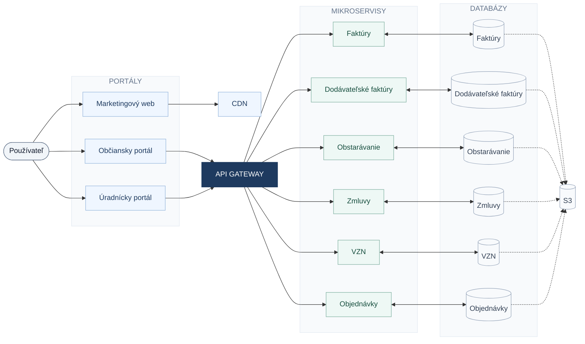
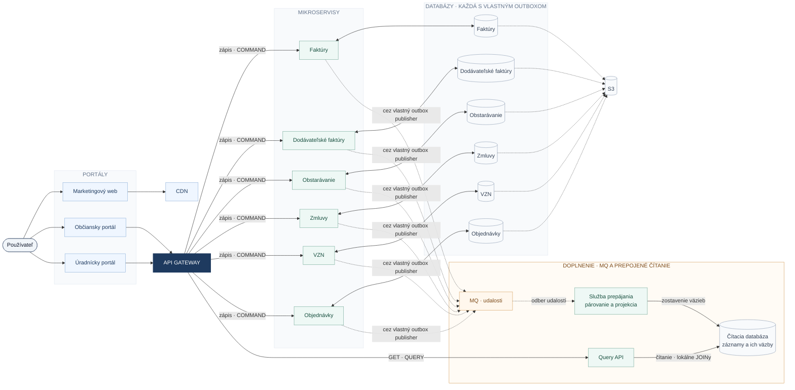

Marketingový web načítava statický obsah cez CDN. Občiansky a úradnícky portál komunikujú s mikroservismi cez spoločnú API gateway. Každá služba má vlastnú databázu; návrh zachováva spoločné úložisko S3.

**Legenda:** plné šípky od portálov cez API gateway označujú smer požiadaviek; odpovede sa vracajú rovnakou cestou. Obojsmerné šípky označujú čítanie a zápis medzi službou a jej databázou. Prerušované šípky do S3 zachovávajú väzby z pôvodného nákresu; mechanizmus prenosu zostáva otvorený.

Správa identity a autentifikácia sú zatiaľ mimo rozsahu tejto schémy.

# Návrh s CQRS a udalosťami

Zápis zostáva v samostatných doménových službách. Ich udalosti cez MQ aktualizujú spoločný čítací model, ktorý prepája obstarávanie → objednávky → zmluvy → faktúry. JOINy sa vykonávajú nad lokálnymi kópiami v read databáze; služba párovania nečíta priamo cudzie doménové databázy.

**Čítanie diagramu:** pôvodné portály, CDN, API gateway, všetkých šesť služieb, ich databázy a S3 zostávajú zobrazené samostatne. Oranžová skupina dopĺňa MQ a čítaciu vetvu CQRS. Každá služba ukladá záznam aj udalosť do vlastnej databázy v jednej transakcii; prerušovaná šípka zo služby do MQ zahŕňa odoslanie cez jej outbox publisher. Služba prepájania odoberá udalosti, vyhľadáva súvisiace záznamy v čítacej databáze a aktualizuje väzby. Query API poskytuje spoločné prehľady cez gateway. Čítacia databáza je odvodený pohľad; zdrojom pravdy zostávajú doménové databázy. Pôvodné väzby databáz na S3 sú zachované a ich mechanizmus zostáva otvorený. Marketing používa CDN; identita zostáva mimo rozsahu.

## Ako prebehne vytvorenie faktúry

1. Úradník odošle faktúru cez API gateway do služby Faktúry. Ak pozná súvisiacu zmluvu, uvedie jej `zmluva_id`.

2. Služba v jednej databázovej transakcii uloží faktúru aj udalosť `FakturaVytvorena` do vlastnej outbox tabuľky. Po potvrdení transakcie vráti ID faktúry; prepojený pohľad sa ešte môže spracúvať.

3. Outbox publisher odošle potvrdenú udalosť do MQ. Ako odoslanú ju označí až po potvrdení brokera; pri výpadku odoslanie opakuje.

4. Služba párovania prevezme udalosť, uloží lokálnu kópiu faktúry a v read databáze vyhľadá zmluvu podľa ID a obce. Cez jej existujúce väzby nájde objednávku aj obstarávanie.

5. V jednej transakcii read databázy aktualizuje projekciu, väzby a evidenciu spracovaného `event_id`. Až potom potvrdí správu MQ.

6. Portály načítajú prepojený prehľad cez Query API. Rovnaký postup platí pre vytvorenie alebo zmenu obstarávania, objednávky a zmluvy.

## Pravidlá prepájania

| Záznam | Navrhovaná explicitná väzba | Správanie projekcie |
| --- | --- | --- |
| Obstarávanie | `obstaravanie_id` | Založí koreň prehľadu a preverí čakajúce objednávky. |
| Objednávka | `objednavka_id`, voliteľné `obstaravanie_id` | Pripojí objednávku k obstarávaniu. |
| Zmluva | `zmluva_id`, voliteľné `objednavka_id` | Pripojí zmluvu k objednávke a cez ňu k obstarávaniu. |
| Faktúra | `faktura_id`, voliteľné `zmluva_id` | Pripojí faktúru k zmluve a zostaví dostupný reťazec. |

Toto je navrhovaný model väzieb, nie povinný pracovný postup. Záznam môže vzniknúť aj samostatne a odkaz možno doplniť neskôr príkazom do jeho doménovej služby. Jedna zmluva môže mať viac faktúr; prehľad nesmie predpokladať iba jeden záznam na každom stupni. Ak doména potrebuje väzby M:N, napríklad jednu faktúru k viacerým zmluvám, použije sa explicitný zoznam väzieb a potvrdia sa jeho pravidlá.

**Dodatočné párovanie:** ak faktúra dorazí pred zmluvou, projekcia uloží jej odkaz ako čakajúci. Keď príde udalosť o zmluve, opätovne preverí aj už uložené faktúry. Rovnaké pravidlo platí pre všetky stupne reťazca; nemožno sa spoliehať na globálne poradie správ z rôznych služieb.

**Nejasné väzby:** bez explicitného ID možno podľa externého čísla dokumentu a ďalších dohodnutých údajov vytvoriť návrh zhody. Samotné IČO dodávateľa nestačí na automatické priradenie. Stavy rozlišujú `bez odkazu`, `čaká na súvisiaci záznam`, `prepojené` a `vyžaduje potvrdenie`. Potvrdenie alebo oprava ide cez doménovú službu a novú udalosť, nie ručným prepisom read databázy.

## Udalosti a spoľahlivosť

Každá udalosť nesie `event_id`, `event_type`, `schema_version`, `entity_type`, `entity_id`, `entity_version`, `obec_id`, `occurred_at` a údaje potrebné na projekciu vrátane odkazov. Faktúra nesie napríklad `zmluva_id`, číslo, sumu a stav zverejnenia. `obec_id` ohraničuje párovanie medzi obcami; nejde o návrh identity.

- **Duplicitné správy:** konzument používa `event_id`, aby opakované doručenie nevytvorilo duplicitné väzby.

- **Poradie zmien:** pre každý záznam sleduje `entity_version`. Pre tento návrh udalosti obsahujú úplný aktuálny stav potrebný na projekciu, takže staršia verzia neprepíše novšiu. Odstránenie ponechá verziu a príznak odstránenia, aby oneskorená správa záznam neobnovila.

- **Zmeny a odstránenie:** udalosti aktualizujú aj odkazy, stav zverejnenia a dotknuté prehľady. Odstránenie nadradeného záznamu nezmaže automaticky faktúry; väzba sa označí ako nedostupná podľa doménových pravidiel.

- **Výpadky:** MQ používa trvalé správy a odber. Dočasné chyby sa opakujú s odstupom; správy, ktoré sa nedajú spracovať, prejdú do DLQ s upozornením a možnosťou opravy. Chýbajúca zmluva je bežný čakajúci stav, nie chyba do DLQ.

- **Oneskorenie pohľadu:** read model je aktualizovaný asynchrónne. Portál po zápise ukáže uložený záznam a stav spracovania; negarantuje okamžité zobrazenie celého reťazca.

- **Obnova projekcie:** MQ sa nepovažuje za trvalý archív. Obnova použije konzistentné exporty zo zdrojových služieb s verziami a následné udalosti zachytené od začiatku exportu. Tento postup treba overiť pred nasadením.

- **Verejné údaje:** Query API občianskeho portálu poskytuje iba zverejnené údaje vrátane prepojených dokumentov.

## Rozsah CQRS

CQRS tu oddeľuje príkazy na zápis od dotazov nad prepojeným čítacím modelom. Automatické párovanie vytvára odvodené väzby pre zobrazenie; nenahrádza autoritatívne obchodné rozhodnutie. Návrh nevyžaduje event sourcing ani distribuovanú transakciu cez celý reťazec. VZN môže používať rovnaký mechanizmus projekcie bez povinného zapojenia do tohto reťazca.
