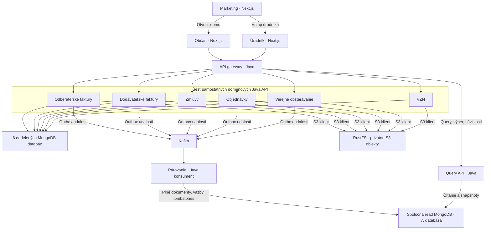

# OpenObec – realizačný návrh funkčného dema pre Žilinu

Dátum: 1. 11. 2026
Stav: schválené používateľom 1. 11. 2026; implementácia prebieha.

**Následné záväzné spresnenie používateľa:** frontend používa iba shadcn/ui. Z IDSK3 sa preberajú výhradne farby; písmo Source Sans Pro a ďalšie IDSK štýly sa nepoužijú. Všetky staršie zmienky o IDSK typografii v tomto dokumente sú týmto spresnením nahradené štandardnou typografiou shadcn/ui (Geist). Architektúra a funkčný rozsah zostávajú schválené.

## 1. Zámer a hranice

Občan nájde mestský dokument cez jedno vyhľadávanie alebo výber agendy, otvorí celý detail, súvisiace dokumenty a prílohy. Úradník vytvorí koncept, vyplní údaje, pridá súbory a explicitné súvislosti, zverejní záznam a overí jeho zobrazenie občanovi. Zmena sa uloží do skutočnej databázy a prežije reštart.

Prvá verzia je používateľom potvrdené **lokálne demo pre jednu obec – Žilinu**. Marketing začne obrazovým návrhom; pracovné portály vzniknú priamo v kóde. Párovanie a Query API môžu podľa výslovného potvrdenia zdieľať jednu odvodenú čítaciu databázu. Šesť doménových služieb má vlastné MongoDB databázy.

Súčasťou sú tri samostatné Next.js aplikácie, API gateway, šesť Java doménových API, Java párovanie, Java Query API, MongoDB, Kafka a RustFS. Spúšťanie bude existovať pre celý Docker stack aj pre jednotlivé aplikácie na hostiteľovi s infraštruktúrou v Dockeri.

Mimo rozsahu: produkčné prihlásenie, občianske účty, reálne napojenie CORA GEO alebo iného IS, externé registre, inteligentné/AI vyhľadávanie, automatická anonymizácia, právna kalkulácia lehôt, automatické publikovanie do CRZ/CUET a produkčné nasadenie. Tlačidlo vstupu do dema nevytvára bezpečnostnú hranicu.

Všetky ukážkové dokumenty aj prílohy budú označené ako fiktívne. Žilina sa nesmie prezentovať ako potvrdený zákazník ani sa nesmie predstierať oficiálny mestský portál.

### Podklady a záväznosť

[Analýza podkladov](../../analysis/2026-11-01-source-review.md) obsahuje mapu všetkých 46 operácií, rozdiely a zdroje. Presné snímky štyroch Pages sú v [manifest.json](../../references/2026-11-01/manifest.json). [PRODUCT.md](../../../PRODUCT.md) zachytáva potvrdený produktový kontext.

Pri rozpore rozhoduje posledný výslovný pokyn používateľa, potom podrobný API kontrakt. High-level cudzie kľúče ako `zmluva_id` sa nepoužijú namiesto záväzného `suvisiace_zaznamy`.

## 2. Zvolený prístup a alternatívy

**Zachovaný používateľov návrh: doménové služby + outbox + Kafka + odvodený CQRS model.** Doménové API sú zdrojom pravdy. Párovanie zostavuje read model a Query API poskytuje spojené čítanie. Toto zodpovedá dodaným schémam aj sekvenčným diagramom.

Alternatíva so skladaním každého detailu volaním všetkých doménových API by zjednodušila úvodný zápis, ale zvýšila závislosť čítania od dostupnosti všetkých služieb a porušila návrh joined view. Preto sa nepoužije.

Alternatíva s vlastnou databázou párovania a ďalšou databázou Query API by zachovala absolútne oddelenie úložísk, ale vyžadovala by druhú asynchrónnu projekciu. Používateľ namiesto nej výslovne zvolil zdieľanú read databázu pre tieto dve služby.

Monolit ani SQL databáza nenahradia zadané mikroslužby a MongoDB.

## 3. Technológie

| Časť | Voľba | Dôvod |
| --- | --- | --- |
| Tri portály | Next.js App Router, TypeScript, React | Požiadavka zadania, nezávislé aplikácie a buildy. |
| UI | shadcn/ui, Tailwind CSS, spoločný UI balík | Prístupné komponenty, zdieľanie vzhľadu aj opráv. |
| Písmo a farby | Source Sans Pro a aktuálna paleta IDSK | Priama požiadavka; fonty lokálne vrátane slovenských znakov. |
| Gateway | Spring Cloud Gateway WebFlux | Java ekosystém, explicitné smerovanie, request ID, timeouty a jednotné chyby. |
| Domény, pairing, query | Java 21, Spring Boot 3.5.x, Maven Wrapper | Jednotný build a konfigurácia, MongoDB a Kafka podpora. |
| Cloud BOM | Spring Cloud 2025.0.x kompatibilný s Boot 3.5.x | Overená kompatibilná rada; konkrétne opravné verzie sa uzamknú pri implementácii. |
| Databázy | MongoDB 8.x, lokálne jednočlenné replica sety | Atómové transakcie dokument + outbox a konzument + deduplikácia. |
| MQ | Apache Kafka v KRaft režime | Požadované udalosti bez ďalšej služby ZooKeeper. |
| Súbory | RustFS a AWS SDK for Java v2 S3 klient | S3 kompatibilné rozhranie a oddelenie blobov od metadát. |
| Vývoj a spustenie | pnpm workspace, Docker Compose v2 | Jeden repozitár, aplikácie sa spúšťajú aj samostatne. |
| Overenie | JUnit, Testcontainers, API kontrakty, Playwright | Overenie reálnych transakcií, udalostí a občianskeho toku. |

Použije sa kompatibilná stabilná sada verzií. Presné verzie JavaScript balíkov, Maven závislostí a kontajnerových obrazov sa zapíšu do lockfile/BOM a manifestu; runtime nebude používať pohyblivé `latest`. Konkrétny patch sa musí overiť zostavením, nie odhadnúť z dokumentácie.

[Spring Cloud matica](https://github.com/spring-cloud/spring-cloud-release/wiki/Supported-Versions), [shadcn monorepo](https://ui.shadcn.com/docs/monorepo), [MongoDB transakcie](https://www.mongodb.com/docs/v8.0/data-modeling/enforce-consistency/transactions/) a [RustFS kontajner](https://docs.rustfs.com/en/installation/container) sú overené technické východiská.

## 4. Architektúra a vlastníctvo



Diagram skracuje šesť fyzicky oddelených doménových databáz do jedného vizuálneho uzla. Medzi databázou a RustFS nie je automatický prenos: súbory prenáša aplikácia.

### Aplikácie a porty

| Priečinok | Zodpovednosť | Lokálny port | Databáza |
| --- | --- | --- | --- |
| `apps/marketing` | Home, výhody, kontakt, vstup do dema | 3000 | žiadna |
| `apps/citizen` | Verejné vyhľadanie, zoznamy, plné detaily, prílohy | 3001 | žiadna |
| `apps/office` | Demo vstup, dashboard, evidencia, formuláre, IS ukážka | 3002 | žiadna |
| `services/api-gateway` | Smerovanie, limity, vstupné kontroly | 8080 | žiadna |
| `services/invoices-service` | `faktury`, odberateľ, sumy a dátumy | 8081 | `openobec_invoices` |
| `services/supplier-invoices-service` | `dodavatelske-faktury`, dodávateľ a sumy | 8082 | `openobec_supplier_invoices` |
| `services/contracts-service` | `zmluvy`, zmluvná strana a platnosť | 8083 | `openobec_contracts` |
| `services/orders-service` | `objednavky`, dodávateľ a termín dodania | 8084 | `openobec_orders` |
| `services/procurement-service` | `verejne-obstaravanie`, CPV, lehota, stav | 8085 | `openobec_procurement` |
| `services/ordinances-service` | `vzn`, schválenie a účinnosť | 8086 | `openobec_ordinances` |
| `services/query-api` | 16 existujúcich read operácií; snapshoty výsledkov | 8090 | zdieľaná `openobec_read` |
| `services/pairing-service` | Udalosti, lokálne kópie, vlastníci hrán, čakajúce odkazy | 8091, prevádzkové API | zdieľaná `openobec_read` |

Párovanie zapisuje projekciu, Query API číta projekciu a zapisuje iba svoje snapshot kolekcie. Jediná výnimka zo samostatného vlastníctva DB je schválená CQRS vetva. Gateway nemá obchodné dáta ani databázu.

V dema režime bude sedem Mongo kontajnerov s vlastnými volumes a replica set názvami, porty hostiteľa 27017–27023. Kafka má samostatný interný a hostiteľský listener. RustFS používa S3 port 9000 a konzolu 9001. Aplikačné a infraštruktúrne porty sa mapujú iba na localhost.

## 5. Adresárová štruktúra

```text
OpenObec/
  apps/
    marketing/                         # vlastný package.json, Dockerfile, README
    citizen/                           # vlastný package.json, Dockerfile, README
    office/                            # vlastný package.json, Dockerfile, README
  packages/
    ui/                                # shadcn/ui a IDSK tokeny, fonty s licenciou
    api-client/                        # generované typy, API klient a error handling
    config/                            # zdieľaná TypeScript a lint konfigurácia
  services/
    api-gateway/
    invoices-service/
    supplier-invoices-service/
    contracts-service/
    orders-service/
    procurement-service/
    ordinances-service/
    pairing-service/
    query-api/
  libs/java/
    common-api/                        # hlavičky, obaly, request ID; bez doménových modelov
    event-contracts/                    # verziované udalosti a schémy
    file-storage/                      # S3 adaptér a spoločné prílohové metadáta
  contracts/
    openapi.yaml                       # 46 existujúcich operácií + označené doplnenia
    events/                            # JSON schémy a fixture udalosti
  infra/
    mongo/                             # init replica setov, readiness
    kafka/                             # topicy a listenery
    rustfs/                            # init bucketu a oprávnenia volumes
  scripts/
    dev/                               # spustenie, zastavenie a diagnostika
    seed/                              # idempotentné demo dáta cez API
    smoke/                             # od zápisu po verejný detail a súbor
    rebuild/                           # offline obnova odvodeného read modelu
  tests/
    contracts/
    integration/
    e2e/
  docs/
    analysis/
    references/
    superpowers/specs/
    superpowers/plans/                 # vykonávací plán až po schválení návrhu
  .impeccable/
    config.json
    mocks/
    review/
  PRODUCT.md
  DESIGN.md                            # vznikne až z vybraného vizuálneho smeru
  pom.xml                              # Maven reactor
  mvnw + .mvn/
  package.json + pnpm-workspace.yaml + pnpm-lock.yaml
  compose.yaml                         # infraštruktúra
  compose.apps.yaml                    # aplikácie pre celý Docker stack
  .env.example
  README.md
```

Každá Java služba bude mať vlastný `pom.xml`, `src`, `Dockerfile`, README a Maven Wrapper alebo wrapper spúšťač ukazujúci na koreň. Zdieľané Java balíky neobsahujú univerzálny CRUD model, ktorý by rušil hranice domén. Každá služba má konkrétne DTO, validátory, repository, API a testy.

## 6. Dátový a API kontrakt

### Spoločné pravidlá

Jediné konfigurované `obec_id` bude `zilina`; príklady `obec_001` sú iba ilustrácia zdrojov. Každé dátové volanie vyžaduje `X-Obec-Id: zilina`. Chýbajúca alebo iná obec v lokálnom jednomeštovom profile znamená 400. Kontrola obce sa vykonáva aj v službách, nielen na gateway.

Server generuje prefixed ID (`fak_`, `dfak_`, `zml_`, `obj_`, `vo_`, `vzn_` s jedinečnou časťou), UTC časy a obec. API zachová slovenské názvy polí a všetky pôvodné HTTP metódy vrátane POST `/update` a POST `/delete`.

Šesť agend má presné polia zo zdrojových tabuliek. Faktúry obsahujú odberateľa, dodávateľské faktúry dodávateľa; nejde o tú istú agendu s iným názvom. VZN nemá meny, sumy, väzby ani verejné `entity_version`.

Peniaze sa v Jave počítajú ako BigDecimal a v Mongo ukladajú presne, napríklad Decimal128; API používa desatinný string s dvoma miestami. Žiadne float/double súčty. Ak sa zmení jediná suma na faktúre, validuje sa výsledný celok aj presný súčet DPH.

Dátumy bez času sú LocalDate; termín obstarávania má časové pásmo a uloží sa ako UTC okamih. UI zobrazuje dátumy a čas v Europe/Bratislava, sumy cez sk-SK a EUR. Dátum účinnosti zadáva úradník; systém ho nevypočítava podľa právnych predpisov.

`datum_schvalenia` VZN bude povinný YYYY-MM-DD (doplnenie neúplnej bunky `undefined`). Ostatné chronologické pravidlá ostávajú presne zo zdrojov: splatnosť ≥ vystavenie, dodanie ≥ objednanie, platnosť ≥ účinnosť.

### Zápisy

- Create: povinné doménové polia; `zverejnene` predvolene false, väzby v piatich agendách predvolene `[]`.
- Update: aspoň jedno upraviteľné pole; vynechané sa zachová, nullable možno vyčistiť cez null. Protistrana sa nahrádza celým objektom.
- Neznáme a serverové vstupné polia: 422. Chybný JSON: 400. Nesprávny Content-Type: 415.
- `cislo` má unique index v rámci obce a agendy; návrh rezervuje číslo aj po logickom zmazaní.
- Delete: prvýkrát 200 s `id, deleted, deleted_at`, potom 404. Nevytvára sa fyzické kaskádové mazanie súvisiacich dokumentov.
- Transakcia v piatich agendách zapíše dokument, novú verziu, audit a outbox. Uloženie VZN je lokálne atómové bez účasti párovania.
- Všetky domény udržiavajú internú verziu na CAS. Pri súbežnej zmene sa patch opätovne aplikuje na najnovší dokument a znovu validuje; nesmie prepísať nezmenené polia starou kópiou. Posledný potvrdený zápis rozhoduje pri zmene rovnakého poľa. Po vyčerpaní krátkeho retry sa vráti 409, nie falošný úspech.

Žiadna zmena nepridáva `entity_version` ako akceptované pole zápisu. Verziu vlastní server.

### Zoznamy a chyby

Zachovať page od 1, page_size 1–100, q najviac 200 znakov, predvolené `-created_at`, povolené štyri sort hodnoty a sekundárne radenie ID vzostupne. q hľadá v čísle, predmete a prípadnom názve; regex sa escapuje, nepoužíva sa ako používateľský program.

Všetky filtre sa kombinujú AND. Prázdna aj príliš vzdialená stránka je 200 s prázdnym poľom. Pri nule zhôd je total_pages 0. Nesprávne query je 400. Chyby majú `error.code, message, details[], request_id`; `details` je pole aj bez chýb konkrétneho poľa.

OpenAPI musí pokrývať všetkých 46 operácií a po doplnení príloh aj ich osobitné odpovede. Z neho vzniknú TypeScript typy a kontraktové fixture; nemení sa existencia doménových Java DTO.

## 7. Explicitné väzby

Záväzný tvar je `suvisiace_zaznamy: [{typ,id}]`, najviac 100 dvojíc. Cieľové typy sú podľa tabuľky zdroja. VZN, odkazy v rovnakej agende a priame odkazy medzi dvoma fakturačnými agendami nie sú povolené.

Vynechanie pri update zachová odkazy; nové pole celý vlastný zoznam nahradí; `[]` ho vyčistí; null je 422. Duplicity sú chyba.

Služba overí iba nové dvojice cez detailové API vlastníka s rovnakou obcou. Nesmie validovať podľa oneskoreného read modelu ani čítať cudziu doménovú databázu. Neplatný cieľ je 422 INVALID_REFERENCE; nedostupný vlastník je 503 a zdroj sa neuloží. Timeouty a limit súbežných overení musia zabrániť 100 dlhým sekvenčným timeoutom.

Vlastníctvo je na zdrojovom zázname. Hrana v read modeli má kanonický neusporiadaný pár koncov a množinu vlastníkov; unikátny index zabráni duplicitným hranám. Odstránenie tvrdenia A nezruší tvrdenie B. Verejný priechod filtruje každý uzol a nepokračuje cez koncept ani zmazaný dokument.

## 8. Udalosti, párovanie a obnova

Jedna verzovaná topic rodina `openobec.documents.v1` prenáša úplné snapshoty z piatich párovaných agend; kľúč je obec + typ + ID. Samostatný `openobec.documents.v1.dlq` uchová problematické správy. Konkrétny počet partícií a retenčné hodnoty sa zaznamenajú pri implementácii; lokálne ide o jeden broker.

Obálka udalosti obsahuje presne identitu zo zdrojov: `event_id, event_type, schema_version, entity_type, entity_id, entity_version, obec_id, occurred_at` a úplný aktuálny stav. Delete obsahuje identitu, novú verziu a tombstone. Veľké súbory sa cez Kafka neposielajú.

Publisher číta iba potvrdené outbox položky, publikuje s potvrdením brokera a až potom označí položku za odoslanú. Pri páde medzi týmito krokmi môže poslať duplicitu. Pri výpadku Kafka ostáva záznam uložený a outbox čaká. Claim/lease v Mongo bráni tomu, aby dva publishery trvalo súťažili o tú istú položku.

Párovanie v jednej read DB transakcii:
1. Overí schému, event_id a vyššiu entity_version.
2. Uloží úplnú kópiu dokumentu alebo tombstone.
3. Nahradí iba tvrdenia vlastníka udalosti, aktualizuje hrany a čakajúce odkazy.
4. Uloží spracované event_id/verziu.
5. Až po commite potvrdí Kafka offset.

Duplicitné a staršie udalosti nemenia projekciu. Tombstone uchová verziu, takže oneskorená stará udalosť neobnoví zmazaný dokument. Cieľ doručený neskôr vyrieši čakajúce odkazy oboma smermi. Zmena alebo vymazanie cieľa sa prejaví pri každom koreni bez uloženého neaktuálneho celého reťazca pri každom dokumente.

Dočasná chyba úložiska sa opakuje s odstupom a viditeľným stavom služby; nekončí tichým zahodením správy. Neopraviteľná schéma alebo chyba dát po obmedzenom retry smeruje do DLQ; offset sa potvrdí až po potvrdenom zápise do DLQ. Chýbajúci cieľ je čakajúci stav, nie chyba do DLQ. Súčasťou je postup nápravy a opätovného prehratia DLQ.

### Kolekcie a indexy

Doménové DB: `documents`, `outbox`, `audit`, `attachments`. Indexy pre obec + cislo (unique), obec + published/deleted + sort polia, outbox pending/lease a attachment vlastník. Nullable a deleted polia budú mať jednotnú reprezentáciu.

Read DB: `records`, `reference_claims`, `edges`, `processed_events`, `pending_references`, `query_snapshots`, `query_snapshot_chunks`, `projection_metadata`. Kľúče vždy zahŕňajú obec. Graf je odvodený, nie nový zdroj obchodnej pravdy. Veľký graf sa neukladá do jedného Mongo dokumentu.

### Obnova read modelu

Kafka sa nepovažuje za úplný archív. Rebuild bude dokumentovaný lokálny servisný postup s dočasnou nedostupnosťou query:
- Pred exportmi zachytiť počiatočné Kafka offsety a pozastaviť bežné párovanie.
- Doménové služby poskytnú interný verziovaný konzistentný export vrátane tombstones; gateway tieto servisné cesty nezverejní.
- Vytvoriť novú generáciu read modelu rovnakou projekčnou logikou.
- Prehrať správy od zachytených offsetov; entity_version zamedzí prepisu novšieho exportu starou správou.
- Po dobehnutí na určenú hranicu overiť počty a fixture reťazec, prepnúť aktívnu generáciu a obnoviť bežný odber.
- Pri zlyhaní ponechať starú generáciu a poskytnúť postup opakovania.

Presné balenie interného exportu a servisného spúšťača je rozhodnutie implementátora; musí však existovať vykonateľný a integračne overený rebuild, nie iba opis.

## 9. Query API a konzistentné detaily

Query API obsluhuje jeden výberový endpoint, päť `/suvislosti` a desať joined list/detail endpointov, spolu 16 existujúcich read operácií. VZN zostáva na svojich piatich doménových cestách.

Bežný zoznam piatich agend číta lokálne plné kópie v `openobec_read`. Výber vracia súhrny podľa zdroj_typ + typ. Autoritatívny detail na načítanie formulára úradníka ide do vlastniacej doménovej služby, aby sa pri editovaní nepoužil starý query stav.

`/suvislosti` overuje koreň cez doménové API; má hĺbku 1–3 a najviac 100 uzlov. Hrany odkazujú len do vrátených uzlov. Pri skrátení je truncated true.

Joined detail prechádza celý viditeľný komponent obojsmerne. Cykly zastaví visited množina. Na rozdiel od `/suvislosti` sa nesmie potichu zastaviť na 100 uzloch: stránkuje najviac 100 súvisiacich plných dokumentov, bez koreňa.

Prvé volanie vytvorí nemenný výsledkový snapshot na 10 minút pri konzistentnom Mongo snapshot čítaní. Uchová koreň, plné súvisiace dáta, hrany, filtre a časy v hlavičke a veľkostne obmedzených chunk dokumentoch, aby neprekročil BSON limit. Čítanie a zhotovenie snapshotu musí používať rovnaký konzistentný pohľad; neskoršie Kafka zmeny nemenia pokračovanie.

Cursor bude nepriehľadný podpísaný token viazaný na snapshot, obec, typ, root ID, zverejnene, related_page_size, pozíciu a expirácie. Overuje sa podpis aj zhoda parametrov. Expirácia sa kontroluje v aplikácii nezávisle od oneskorenia Mongo TTL čistenia. Neplatný cursor je 400; overiteľne expirovaný 410 CURSOR_EXPIRED. Podpisový kľúč je serverová konfigurácia.

Súvisiace dokumenty sú zoradené podľa typ a id. Každá stránka vracia celý root a hrany incidentné k jej dokumentom, prvá aj hrany koreňa. Konce hrán môžu byť na inej stránke; klient po spojení deduplikuje dokumenty aj kanonické hrany. UI neoznačí detail za úplný pred next_cursor null. Pri vypršaní ponúkne načítanie nového prehľadu.

`projection.status` a `pagination.complete` sú nezávislé: ready/pending opisuje dostupnosť lokálne známych cieľov; complete koniec stránkovania. Existujúci read koreň sa obslúži lokálne. Ak chýba, overí sa iba koreň cez doménové API: neexistuje → 404, existuje → 202 + Retry-After 2, závislosť nedostupná → 503. Pri existujúcom koreni s čakajúcimi cieľmi je 200 + pending.

Nedostupné, už zmazané a odfiltrované ciele sa nerozlišujú falošnými plnými záznamami. Verejný výstup odstraňuje odkazy na skryté ciele aj z vnorených vlastných odkazov. Ready nikdy neznamená garantovanú globálnu aktuálnosť všetkých služieb.

## 10. Prílohy a RustFS – výslovné rozšírenie návrhu

Prílohy nie sú obsiahnuté v pôvodných 46 operáciách. Doplniť štyri operácie pre každú zo šiestich agend (24 konkrétnych operácií); existujúce JSON telá zostávajú nezmenené:

| Metóda | Cesta | Výsledok |
| --- | --- | --- |
| GET | `/rest/v1/{agenda}/{id}/prilohy` | `data[]` s metadátami aktívnych príloh |
| POST | `/rest/v1/{agenda}/{id}/prilohy` | Multipart `file`, 201 + `data` metadát |
| GET | `/rest/v1/{agenda}/{id}/prilohy/{file_id}/download` | Prúd bajtov, Content-Type a bezpečný Content-Disposition |
| POST | `/rest/v1/{agenda}/{id}/prilohy/{file_id}/delete` | Logické odstránenie, 200; opakovanie 404 |

Metadáta odpovede: `id, filename, content_type, size_bytes, sha256, created_at`. Bez S3 hesiel, bucket policy alebo interného objektového kľúča. Vlastníkom metadát je rovnaká doména ako vlastníkom dokumentu. Súbor nie je Mongo blob.

Demo podporí PDF, PNG a JPEG do 20 MiB na prílohu, najviac 10 aktívnych príloh na záznam. Ide o návrhové limity, nie požiadavky pôvodného API. MIME aj základný podpis súboru sa overia; názov je zobrazovaný údaj, nie cesta. Chybný formát je 415, nadlimit 413, neplatná väzba na dokument 404/422 podľa príčiny, úložisko nedostupné 503. Nové chyby používajú spoločný error obal.

Java služba streamuje obsah do privátneho bucketu `openobec-documents` s náhodným kľúčom zahŕňajúcim obec, agendu, dokument a file ID. Prístup používa S3 path-style pre lokálny RustFS endpoint. Browser komunikuje s API, nepotrebuje interný hostname RustFS ani S3 prihlasovacie údaje.

Postup: vytvoriť koncept → upload → uložiť overené metadáta → voliteľne publikovať pôvodným update. Zlyhanie uploadu nemení úspešne uložený koncept a nesmie predstierať dokončenú prílohu. Po zlyhaní DB zápisu sa vykoná kompenzačné odstránenie objektu; servisný postup nájde prípadné osirelé objekty po páde. Neexistuje distribuovaná transakcia Mongo + S3.

Delete dokumentu zneprístupní aj prílohové API. Logické odstránenie prílohy zneprístupní metadáta a download; blob ostáva na účely auditovateľného dema do výslovného resetu. Nemení sa tým doménové `suvisiace_zaznamy`. Prílohy sa načítavajú priamo z doménového API, nemusia sa kopírovať cez Kafka do read modelu.

Občianska obrazovka sprístupní prílohu len po kontrole zverejnenia koreňa. Samotné lokálne API ostáva bez autentifikácie podľa zadania, preto UI filter nie je tvrdenie o produkčnej autorizácii.

## 11. Gateway a komunikácia portálov

Gateway pozná iba explicitné agendy a operácie. Výber, `/suvislosti` a `/query` sa smerujú pred všeobecnými doménovými cestami. Prílohy idú do vlastníka agendy. Žiadne nové catch-all smerovanie do nesúvisiacej služby.

Gateway generuje alebo normalizuje request ID, prenáša ho službám, mapuje nedostupnosť na 503 s rovnakým error obalom a obmedzí veľkosť JSON/multipart a dĺžku čakania. POST zápisy sa automaticky neopakujú na gateway, pretože klient pri strate odpovede nemusí vedieť, či zápis prebehol.

Pre demo stačí pamäťový limiter jedného gateway procesu; Redis nepribudne. Parametre limitu sa konfigurujú a testy majú deterministický profil. 429 obsahuje Retry-After. Limiter má ohraničenú pamäť a nemá slúžiť ako distribuovaná ochrana.

Portály používajú rovnaký pôvod cez Next.js rewrite alebo tenký serverový adaptér. Browser nesmie dostať Docker DNS adresu ani URL zapečené pri builde pre iný režim. Rozlišujú sa interné API adresy servera a adresy portálov v prehliadači. Riešenie musí fungovať v dev aj v troch nezávislých Docker kontajneroch.

Úradnícke read-after-write: úspešná odpoveď doménovej služby okamžite zobrazí uložený záznam, neskôr sa obnoví query prehľad. Verejné dynamické údaje používajú no-store alebo výslovnú invalidáciu, aby Next cache nepridávala ďalšie skryté oneskorenie.

## 12. Tri portály a Impeccable

### Spoločná vizuálna báza

Použiť skutočné shadcn/ui komponenty v `packages/ui`: Button, Input, Label, Table, Select/Combobox, Dialog, AlertDialog, Badge, Sheet, Tabs, Skeleton a ďalšie podľa potreby. Nahradiť ich neutrálne tokeny farbami IDSK; nekopírovať iba mená komponentov do vlastných neprístupných náhrad.

[IDSK paleta](https://idsk.gov.sk/zaklady-principy/farebna-paleta): primárna #126dff, tmavá #072c66, podklad #ffffff, svetlá #eff5fe, text #212121, chyba #c3112b, úspech #078814. Na malom texte a vyplnených ovládacích prvkoch voliť tmavší odtieň #0b4199 tam, kde svetlá primárna s bielym textom nemá dostatočný kontrast. Kontrast sa skutočne zmeria; príslušnosť farby k palete sama osebe nestačí.

[IDSK typografia](https://idsk.gov.sk/zaklady-principy/typografia): Source Sans Pro, lokálne súbory, rezy Regular/Bold/Black podľa potreby. Žiadna závislosť zobrazenia na Google Fonts. Zrozumiteľná slovenčina, viditeľné focus stavy, sémantické nadpisy a formulárové chyby. Pracovné portály majú jasnú informačnú hierarchiu, čitateľné tabuľky a pokojný vzhľad. Všetky stavy musia fungovať aj klávesnicou.

Finálna kompozícia marketingu zostáva vizuálnym rozhodnutím v Impeccable, nie je predstieraná ako už schválená. Výstupom následného dizajnového kroku bude vybraný obrazový návrh, jeho verná implementácia, DESIGN.md s tokenmi a príslušný záznam Impeccable.

### Marketing – presvedčiť a otvoriť demo

Cesty `/home`, `/vyhody`, `/kontakt`, `/demo`; `/` presmeruje na `/home`. Vysvetliť problém roztrúsených dokumentov, ukázať vyhľadanie a publikačný tok, uviesť zámer ceny 199 €/rok a dve konkrétne CTA na občianske a úradnícke demo.

Nevymýšľať zákazníkov, referencie, ušetrené hodiny ani právne garancie. Implementačný poplatok a DPH sú neurčené; nezavádzať nákupný či platobný tok. Kontakt nesmie tvrdiť odoslanie na nezadaného príjemcu. Namiesto fiktívnej adresy jasne opíše, že ide o demo projektu, a ponúkne jeho otvorenie.

Vizuálne spracovanie: po schválení tohto systémového návrhu absolvovať Impeccable výber smeru a obrazového návrhu. Marketing sa začne implementovať až podľa vybraného návrhu.

### Občan – nájsť a pochopiť dokument

Presné cesty `/obcan/home`, zoznam a detail pre všetkých šesť agend. `/` presmeruje na `/obcan/home`. Hlavná stránka obsahuje vyhľadávacie pole, prechody na agendy a posledné zverejnené ukážkové záznamy s údajom o aktuálnosti.

Jedno vyhľadávanie zavolá päť existujúcich query zoznamov a zoznam VZN paralelne s q a zverejnene=true. Výsledky budú zoskupené podľa agendy, každá s vlastným počtom a prechodom do plného zoznamu. Nepredstierať globálne relevance-radenie ani spoločné stránkovanie. Pri výpadku jednej agendy pomenovať neúplnosť a zachovať ostatné výsledky.

Zoznam má hľadanie, stránkovanie a radenie iba podľa možností API. Detail zobrazí všetky polia agendy, prílohy a plné súvisiace dokumenty. Súvisiace dokumenty načíta cez cursor do konca alebo ich ponúkne po častiach s viditeľným stavom úplnosti. VZN detail overí zverejnenie cez serverový adaptér, keďže pôvodný detail nepodporuje query filter.

Súčasťou sú stavy loading, prázdne dáta, bez výsledkov, 404, nedostupná služba, čakajúca projekcia a expirovaný cursor. Pri chybe nahradiť obsah chybou s opakovaním, nie nekonečným skeletonom. Žiadny účet občana ani open-data katalóg v prvej verzii.

### Úradník – uložiť a publikovať

Cesta `/uradnik/prihlasenie` obsahuje jasný vstup do demo prostredia bez hesla. `/uradnik/home` má dashboard so skutočnými počtami z evidencie a poslednými zmenami. Počty sa získajú z pagination.total existujúcich zoznamov; nepoužijú sa natvrdo nakreslené štatistiky.

Zoznam a detail šiestich agend kopírujú cesty zdroja. Doplnené formulárové cesty `/uradnik/{agenda}/novy` a `/uradnik/{agenda}/{id}/upravit` majú prednosť pred dynamickým ID segmentom. Ovládanie: Uložiť koncept, Zverejniť, Upraviť, Stiahnuť zo zverejnenia a logicky Vymazať s potvrdením.

Priebeh formulára: údaje → voliteľné súvislosti → uloženie konceptu → prílohy → kontrola a zverejnenie. Nie je potrebný nový doménový stavový automat; záväzné `zverejnene` ostáva boolean. Ak nahratie zvoleného súboru zlyhá, UI ponechá koncept a označí neúspešný súbor.

Výber väzieb je viacnásobný s hľadaním podľa povolených cieľov. Vlastné odkazy sú upraviteľné, spätné súvislosti len na čítanie s prechodom na vlastníka. Validácie sa zobrazia pri poliach aj v súhrne a zachovajú vyplnené hodnoty.

Po zápise sa zobrazí skutočný výsledok doménového API. Ak query verzia zaostáva, UI oznámi „Záznam je uložený, prehľad sa aktualizuje“, obnoví ho s odstupom a po ohraničenom počte pokusov ponúkne ručné obnovenie. Samotný stav ready bez porovnania verzie nesmie predstierať doručenie poslednej zmeny.

`/uradnik/settings` obsahuje požadovanú ukážku pripojenia na mestský IS. Jasný stav „Ukážka – bez reálneho pripojenia“, test simulácie a syntetický výsledok; nežiada ani neukladá skutočné heslá mesta. Nie je to funkčný integračný konektor.

## 13. Spustenie a konfigurácia

### Celý stack v Dockeri

Konečný README poskytne presné overené príkazy: vytvorenie lokálneho env zo vzoru, spustenie infra + apps Compose, jednorazový seed a otvorenie troch lokálnych adries. Build prebehne v multi-stage kontajneroch; hostiteľ nepotrebuje JDK ani Maven. Každý z troch Next projektov má vlastný produkčný image.

Compose inituje replica sety, počká na primary, pripraví Kafka topicy a bucket RustFS a až potom spustí závislé aplikácie. Readiness nesmie byť iba „kontajner sa spustil“. Služby majú vlastné opakované pripojenie pri reštarte závislostí; depends_on samo osebe nestačí.

Volumes sú pomenované a izolované. Bežné zastavenie ich zachová. Reset je samostatný výslovný deštruktívny príkaz s potvrdením; seed ani štandardné spustenie nemaže existujúce dáta.

### Ručné aplikácie + Docker infraštruktúra

Hostiteľ bude potrebovať JDK 21, Node v podporovanej verzii a pnpm. Maven nahradí dodaný Wrapper. Root postup najprv zostaví spoločné Java moduly, potom možno v priečinku konkrétnej služby samostatne spustiť Spring Boot. Konkrétna Next aplikácia má samostatný dev a build/start príkaz.

Každý README uvádza svoje závislosti, port, env premenné a príklad spustenia z vlastného priečinka aj z koreňa. Zastavenie jednej aplikácie nesmie ukončiť ostatné.

Mongo URI pre hostiteľa používa localhost mapovaný port, replicaSet a lokálne vhodný directConnection; kontajnerová URI používa príslušný DNS názov. Kafka má odlišné advertised listeners pre hostiteľa a kontajnery. Ich funkčnosť sa musí overiť skutočnými transakciami a publikovaním v oboch režimoch.

### Konfigurácia a diagnostika

`.env.example` obsahuje lokálne demo hodnoty, porty, obec, API adresy, Kafka bootstrap, Mongo URI, RustFS endpoint a privátne serverové nastavenia. Reálne tajomstvá nepatria do git ani do NEXT_PUBLIC premenných. URL pre browser a interné URL zostávajú oddelené.

Pred spustením skript skontroluje dostupnosť Docker engine a voľné porty. Odporúčanie pamäte sa určí meraním celej zostavy; sedem MongoDB a deväť JVM sú výraznejšie nároky než jedna aplikácia. Limity JVM a Mongo cache sa nastavia pre demo a v návode sa uvedie nameraná spotreba.

Health a štruktúrované logy obsahujú názov služby a request_id; bez celých súborov, tajomstiev a citlivých tiel požiadaviek. Párovanie poskytne viditeľné počty spracovaných/chybných udalostí a stav DLQ. Dashboard nesmie prezentovať tieto technické počty ako počet právne splnených publikácií.

## 14. Demo dáta

Seed obsahuje iba `zilina`, aspoň 12 záznamov v každej agende, koncepty aj zverejnené, reálne stránkovanie a aspoň dva rozvetvené prepojené komponenty. Názvy budú viazané na ukážkové mestské potreby; všetky organizácie aj dokumenty označené ako fiktívne. Žiadny import z historickej mapy dodávateľov.

Súčasťou sú skutočne čitateľné syntetické PDF prílohy, nie iba názvy neexistujúcich súborov. Samostatné testovacie fixtures pokryjú viac než 100 súvisiacich záznamov.

Seed ide cez doménové API, súbory cez upload API, aby overil skutočný publikačný tok. Je opakovateľný bez duplikátov a bez prepisu používateľových úprav; identifikuje vlastné seed záznamy cez stabilné evidenčné čísla a manifest seed behu. Postup najprv vytvorí záznamy bez väzieb, potom ich doplní, aby nevznikli neplatné odkazy.

Demo je pripravené až po overení dobehnutia projekcie. Skript nekončí úspechom pri prázdnom občianskom portáli.

## 15. Akceptácia funkčnosti

| Oblasť | Pozorovateľný dôkaz |
| --- | --- |
| Čisté spustenie | Z prázdnych volumes vznikne infraštruktúra, všetky aplikácie a demo dáta; tri portály sa otvoria. |
| Perzistencia | Po bežnom zastavení a spustení zostanú dokumenty aj súbory. |
| Samostatné aplikácie | Každá Next aj Java aplikácia sa spustí ručne podľa svojho README s infra v Dockeri. |
| Šesť agend | CRUD, unikátnosť, dátumy, sumy, nullable polia, čiastočný update a logické delete fungujú podľa kontraktu. |
| API | Overených všetkých 46 pôvodných operácií a 24 prílohových operácií vrátane chýb a response obalov. |
| Celý občiansky tok | Úradník vytvorí koncept s prílohou, zverejní ho, občan ho vyhľadá a stiahne rovnaký obsah so zhodným SHA-256. |
| Súkromie obrazoviek | Koncept nie je vo verejnom zozname, detaile, odkaze, priechode ani prílohovej obrazovke. API demo obmedzenia sú zdokumentované. |
| Väzby | Rovnaký komponent sa načíta z každého koreňa; viac faktúr, cykly, dva vlastníci a odstránenie jedného tvrdenia fungujú. |
| Udalosti | Duplicitná, staršia a prehodená udalosť nevytvorí duplicity ani neobnoví tombstone; oneskorený cieľ doplní graf. |
| Výpadok Kafka | Potvrdený zápis zostane v doméne, outbox po obnove dobehne a query sa aktualizuje. |
| Výpadok cieľového API | Nová neoveriteľná referencia vráti 503 a zdrojová zmena sa neuloží. |
| Výpadok RustFS | Koncept ostane, upload vráti zrozumiteľnú chybu a UI nehlási hotovú prílohu. |
| Cursor | Viac než 100 dokumentov sa načíta úplne, zmeny počas čítania nemenia snapshot; 400/410 a TTL sa rozlišujú. |
| Obnova | Rebuild z doménových exportov a následných udalostí obnoví komponent aj po strate read DB. |
| Rozhranie | Desktop aj mobil, klávesnica, focus, validačné, prázdne a chybové stavy sú vizuálne a funkčne overené. |

Backend sa bude implementovať cez Superpowers postup s testami najprv pre rizikové správanie: peniaze, patche, transakcie, outbox, deduplikáciu, graf a snapshoty. Testcontainers musí používať skutočné Mongo replica sety a Kafka; mock repository nepreukáže transakčnú záruku. Docker smoke overí aj skutočný RustFS.

Playwright overí aspoň úplný publikačný tok, editáciu s väzbami, spätné skrytie dokumentu a občianske vyhľadanie. Súčasťou kontroly budú reálne screenshoty desktop/mobil, konzola prehliadača a chýbajúce sieťové odpovede. Marketing sa porovná s vybraným obrazovým návrhom; Impeccable detector a nezávislý vizuálny reviewer patria až k hotovému UI.

## 16. Poradie dodania a otvorené rozhodnutia

Po schválení vznikne samostatný vykonávací plán Superpowers. Realizácia bude postupovať po funkčných celkoch:
1. Kontrakty a infraštruktúra vrátane overených transakcií.
2. Jedna agenda od vytvorenia cez Kafka a query po prílohu ako overený vzor.
3. Zvyšných päť agend a hraničné stavy grafu/snapshotov.
4. Obrazový návrh marketingu a spoločné UI prvky podľa IDSK.
5. Občiansky a úradnícky portál napojené na skutočné API.
6. Seed, oba režimy spúšťania, rebuild a akceptačný smoke celej zostavy.

Poradie je návrhové, nejde ešte o detailný implementačný plán. Pre chýbajúci lokálny JDK možno overovanie Java služby začať kontajnerovým buildom; inštalácia JDK nie je podmienkou schválenia návrhu.

Používateľom už uzavreté: lokálne demo, Žilina, Java/Mongo/Kafka/RustFS, tri Next.js aplikácie, shadcn/ui + IDSK, marketing obrazom a spoločná read DB pairing/query.

Na schválenie v tomto dokumente sú aj doplnenia: Java gateway, interné `zilina`, 24 prílohových operácií a ich limity, rezervácia evidenčného čísla po delete, vynechanie účtov/open-data, kontakt bez fiktívneho príjemcu, databázové replica sety a vykonateľný rebuild. Implementátor môže rozhodnúť konkrétne opravné verzie, technické názvy tried, detaily UI komponentov, parametre retry a presné balenie servisných skriptov v rámci tu uvedených záruk.

Samostatne ešte treba vybrať konkrétny obrazový návrh marketingu. Jeho budúce schválenie potvrdí vzhľad, nie zmenu rozsahu backendu. Nezadané kontakty, produkčné nasadenie a právne pravidlá sa nevymýšľajú.

**Hotovo bude znamenať preukázaný tok od vytvorenia dokumentu po občianske zobrazenie a stiahnutie prílohy v celej spustenej zostave, nie existenciu priečinkov alebo statických obrazoviek.**
